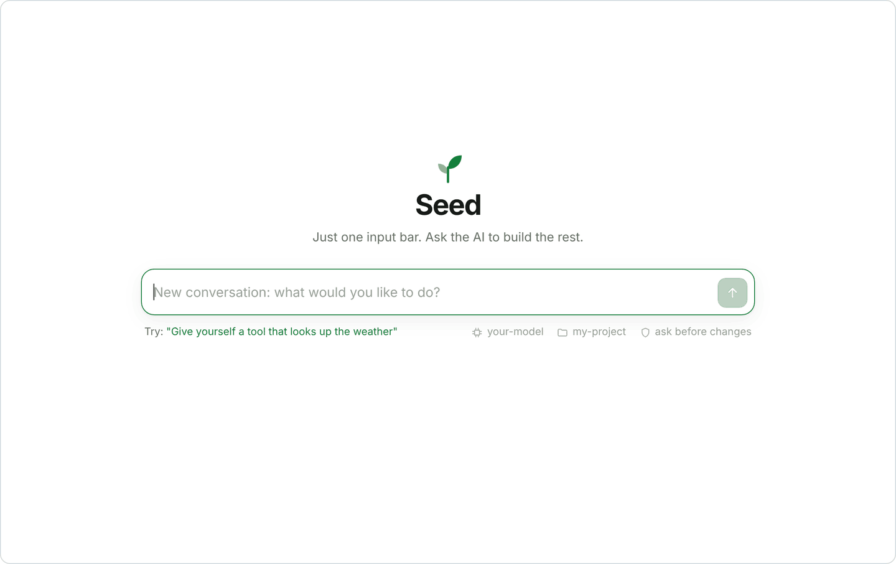
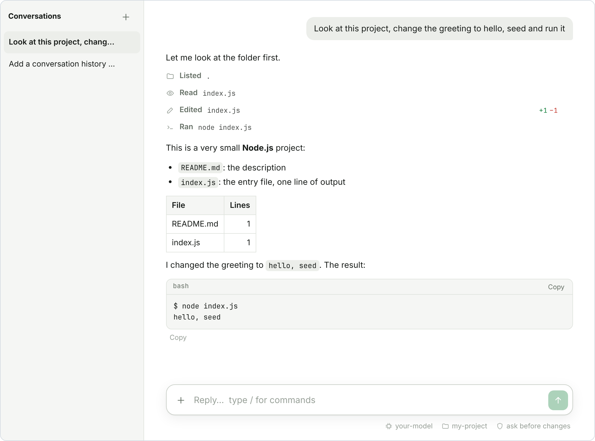
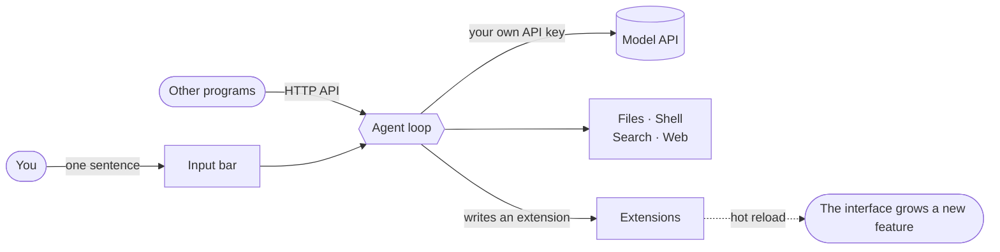
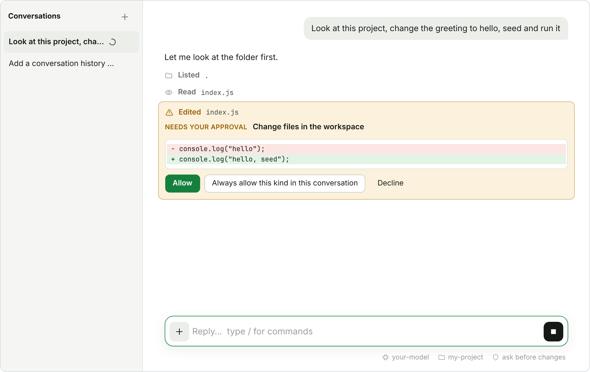

<div align="center">


# Seed

**An AI agent that starts as a single input bar. Every other feature, the AI builds for you.**

[简体中文](README.md) · **English** · [日本語](README.ja.md) · [Français](README.fr.md) · [Русский](README.ru.md)

<p>
<a href="https://github.com/HolyGr41L1337/Seed/actions/workflows/ci.yml"></a>


</p>

<p>
<a href="https://github.com/HolyGr41L1337/Seed/releases/latest"></a>
&nbsp;
<a href="https://github.com/HolyGr41L1337/Seed/releases/latest"></a>
&nbsp;
<a href="https://github.com/HolyGr41L1337/Seed/releases/latest"></a>
</p>

[Download](#download) · [Connect a model API](#connect-a-model-api) · [Let the AI add features](#let-the-ai-add-features) · [Use it through the API](#use-it-through-the-api) · [Docs](#docs-and-development)

</div>

<br>

Seed is an agent harness in the spirit of Codex and DeepSeek Harness: connect your own model API, and it reads and writes files, runs commands, searches code and gets tasks done on your computer.

The difference is the interface, which starts as nothing but a new-conversation bar. A history sidebar, a settings page, themes, new tools, integrations: none of these are built in. You ask the AI, in one sentence, to add them to the app itself, and the page grows them on the spot, with no restart.

<div align="center">
<picture>
  <source media="(prefers-color-scheme: dark)" srcset="docs/images/demo-en-dark.gif">
  
</picture>
<br>
<sub>Tell it “Add a conversation history sidebar to this app”: the AI writes an extension and the sidebar appears on the spot.<br>Recorded from the real app; the model's replies are scripted.</sub>
</div>

## Features

<table>
<tr>
<td width="50%" valign="top">

**🤖 A complete agent**

Streaming replies, visible thinking, tool calls (shell, reading, writing and editing files, directory listing, glob, grep, web fetch, task plan), approval for each action, stop at any time, automatic summarizing of long conversations, and `AGENTS.md` from the working folder.

</td>
<td width="50%" valign="top">

**🌱 It grows itself**

The AI writes each new feature as an extension (plain JavaScript files) that hot-loads when saved. If loading fails, the error goes straight back to the AI with the file name and line number, and it keeps fixing until it works.

</td>
</tr>
<tr>
<td width="50%" valign="top">

**🔌 Bring your own model API**

DeepSeek, OpenAI, OpenRouter, Ollama and any OpenAI-compatible endpoint; Claude through the official Anthropic SDK. Set up several providers and switch at any time, even in the middle of a conversation.

</td>
<td width="50%" valign="top">

**🧩 Other programs can drive it**

Every feature has an HTTP API. There is also an OpenAI-compatible endpoint: point any OpenAI client at Seed and use the whole agent as if it were a “model”.

</td>
</tr>
</table>

An ordinary coding task looks like this: reading files needs no permission, edits and commands ask first, and you get a summary at the end.

<div align="center">
<picture>
  <source media="(prefers-color-scheme: dark)" srcset="docs/images/chat-en-dark.png">
  
</picture>
</div>

## How it works



## Download

On the [Releases](https://github.com/HolyGr41L1337/Seed/releases/latest) page, click the file for your system under **Assets**:

| System | File | How to install |
| --- | --- | --- |
| macOS (Apple silicon: M1/M2/M3/M4…) | `Seed-<version>-mac-arm64.dmg` | Open it and drag Seed into Applications |
| macOS (Intel) | `Seed-<version>-mac-x64.dmg` | Same as above |
| Windows (most PCs) | `Seed-Setup-<version>-x64.exe` | Double-click to install; it opens when done. No administrator rights needed |
| Windows (no install) | `Seed-<version>-win-x64.zip` | Unzip and double-click `Seed.exe` |
| Windows (ARM PCs) | `Seed-Setup-<version>-arm64.exe` | Double-click to install |
| Linux | `Seed-<version>-linux-x86_64.AppImage` | Make it executable, then double-click |

Not sure which chip your Mac has? Open the Apple menu → About This Mac. “Chip: Apple M…” means arm64; “Processor: Intel” means x64.

The app opens as a window with just the input bar and a “Connect a model API” card below it: choose a provider, enter your API key, click Connect, and you are ready to go.

> [!IMPORTANT]
> The installers are not yet signed with paid Apple and Microsoft certificates, so the system stops the first launch. Do the following once; after that the app opens normally.

- **macOS**: if a message says the developer cannot be verified, or that Apple could not check the app for malicious software, click Done. Then open System Settings → Privacy & Security, find the message about Seed near the bottom and click Open Anyway. Or run this once in Terminal:

  ```bash
  xattr -dr com.apple.quarantine /Applications/Seed.app
  ```

- **Windows**: if “Windows protected your PC” appears, click More info, then Run anyway. If the message comes from Smart App Control and has no Run anyway button, turn that feature off under Windows Security → App & browser control, then install.

<details>
<summary><b>Desktop app: menus and behaviour</b></summary>

<br>

- **File → Open Folder…** (`Cmd/Ctrl+O`): the folder where the AI reads and writes files and runs commands. The default is your home folder; pointing it at a specific project is better.
- **File → Copy API Connection Info**: copies the local API address and access token, for connecting other programs (see [Use it through the API](#use-it-through-the-api)).
- **View → Safe Mode**: when an extension has broken the interface, this opens a window that loads no UI extensions.

The desktop app uses the system proxy settings automatically (for example a system proxy turned on by a proxy tool), so reaching OpenAI, Anthropic and other services needs no extra setup. On macOS the app keeps running after you close the window (the API stays available); click it in the Dock to bring the window back, and quit completely with `Cmd+Q`.

The desktop app and the command-line version share the same data (`~/.seed`): conversations, settings and extensions are common to both.

</details>

## Connect a model API

The connect card in the app is the easiest way (type `/connect` to open it again at any time). You can also set environment variables before starting, and Seed picks them up:

| Environment variable | Provider |
| --- | --- |
| `ANTHROPIC_API_KEY` | Claude (Anthropic) |
| `DEEPSEEK_API_KEY` | DeepSeek |
| `OPENAI_API_KEY` (optionally with `OPENAI_BASE_URL`) | OpenAI |
| `OPENROUTER_API_KEY` | OpenRouter |

For any other provider, choose “Custom (OpenAI-compatible)” or “Custom (Anthropic-compatible)” in the connect card and enter the base URL, the key and the model name.

To switch models, type `/model` and pick from the list, or type `/model deepseek/deepseek-reasoner`.

<details>
<summary><b>The config file in full</b></summary>

<br>

Settings are stored in `~/.seed/config.json` (file mode 600; keys stay on your computer). A provider written out in full:

```json
{
  "providers": {
    "deepseek": {
      "type": "openai",
      "baseURL": "https://api.deepseek.com",
      "apiKey": "$DEEPSEEK_API_KEY",
      "params": { "max_tokens": 8192 },
      "contextWindow": 128000
    }
  },
  "model": "deepseek/deepseek-chat"
}
```

- `apiKey` can hold the key itself or `"$ENV_VARIABLE_NAME"`, so that the key is never written to disk.
- `params` is merged as it is into every request. Provider-specific switches (`temperature`, `reasoning_effort`, DeepSeek's `thinking` and so on) go here.
- `contextWindow` is the model's context length. When a conversation gets close to it, Seed has the model summarize the earlier part and then carries on.
- Models such as DeepSeek's require earlier `reasoning_content` to be sent back in thinking mode. Seed does this for you, and switches automatically for endpoints that do not accept it.
- Claude uses the official SDK. The default model is `claude-opus-5-5`, with adaptive thinking and prompt caching on. For models that support it, **server-side fallback** is also on by default (when a safety classifier blocks a request by mistake, another model recommended by Anthropic answers instead). To turn it off, add `"fallbacks": false` to that provider's `params`. `params` also accepts `effort` (`low` to `max`) and `maxTokens`.
- If you need a proxy, set `HTTPS_PROXY` as usual; Seed respects it.

</details>

## Let the AI add features

Just say it:

- “Add a conversation history sidebar to this app”
- “Add a settings page where I can switch the model and the approval mode”
- “Add a dark / light theme toggle button”
- “Give yourself a tool that looks up the weather”
- “Add a read-aloud button under every answer”

The AI first reads [docs/EXTENDING.md](docs/EXTENDING.md), writes the extension under `~/.seed/extensions/<name>/`, calls `reload_extensions` to check that it loaded, looks at the real page with `ui_eval`, and once everything works tells you how to use it.

Extensions can add interface (sidebars, panels, buttons, full-page views, slash commands, keyboard shortcuts) and backend abilities (new tools for the AI, HTTP endpoints, hooks, scheduled jobs, new kinds of model API).

- Type `/extensions` to list, disable or delete extensions.
- If an extension breaks the interface, type `/safe` (or add `?safe=1` to the address) to open the page without UI extensions, then ask the AI to fix it. `seed --safe` starts with no extensions at all.
- [examples/extensions/](examples/extensions/) has three complete examples: a history sidebar, a theme toggle, and memory across conversations. To use one as it is, copy its folder into `~/.seed/extensions/`.

> [!NOTE]
> Extension code has full access (UI extensions can call the whole API; backend extensions can do anything Node.js can), so writing extension files is an approval category of its own: in every mode except `full`, Seed asks you first.

## Approval modes

Before the AI does anything with consequences, it asks you. The card offers three choices: “Allow”, “Always allow this kind in this conversation” and “Decline”.

<div align="center">
<picture>
  <source media="(prefers-color-scheme: dark)" srcset="docs/images/approval-en-dark.png">
  
</picture>
</div>

| Mode | Behaviour |
| --- | --- |
| `ask` (default) | Reading files in the working folder needs no permission. Running commands, changing files, network access and changing the app's settings all need your OK. A few read-only commands (`ls`, `cat`, `git status` and the like) run without asking. |
| `auto-edit` | File changes inside the working folder are allowed automatically; everything else as above. |
| `full` | Everything is allowed. |

Switch with `/mode`. After you decline, the AI stops and waits for your instructions; it does not try another route.

## Use it through the API

The access token is printed at start-up, and `seed url` shows it again at any time. In the desktop app, use the menu File → Copy API Connection Info.

**As an OpenAI endpoint** (base URL `http://127.0.0.1:7333/v1`, the access token as the API key, model `seed`):

```python
from openai import OpenAI

client = OpenAI(base_url="http://127.0.0.1:7333/v1", api_key="<access token>")
reply = client.chat.completions.create(
    model="seed",
    messages=[{"role": "user", "content": "Which TODOs are there in this repository?"}],
)
print(reply.choices[0].message.content)
```

Nobody can click an approval on this route, so by default it may only read. To let it act, send the request header `x-seed-approval: auto-edit` or `full`.

**One call, one finished task**:

```bash
curl http://127.0.0.1:7333/api/chat \
  -H "Authorization: Bearer <access token>" -H "Content-Type: application/json" \
  -d '{"message": "Run the tests and summarize why they fail", "approval": "full"}'
```

Add `"stream": true` for a live event stream. Conversations, approvals, settings, extensions, event subscriptions and everything else are described in [docs/API.md](docs/API.md).

## Commands

Type `/` in the input bar to open the command menu:

| Command | What it does |
| --- | --- |
| `/new` | Start a new conversation |
| `/connect` | Connect or change a model API |
| `/model [provider/model]` | Show or switch the model |
| `/mode [ask\|auto-edit\|full]` | Switch the approval mode |
| `/cd <folder>` | Change the working folder |
| `/compact` | Summarize the earlier part of the conversation |
| `/extensions` | List and manage extensions |
| `/stop` | Stop the current task |
| `/safe` | Reopen the page in safe mode |
| `/help` | List all commands (including those added by extensions) |

<details>
<summary><b>Command line</b></summary>

<br>

```bash
seed                        # start (interface + API)
seed --port 8080 --cwd ~/code/app
seed exec "fix the failing tests"      # no interface: run one task in the terminal
seed exec --approval full --json "…"   # for scripts: allow everything, one JSON event per line
seed url                    # print the address with the token
seed --safe                 # start without extensions
```

The command-line version is installed from source; see [Docs and development](#docs-and-development).

</details>

## Security

> [!WARNING]
> **There is no OS-level sandbox.** Safety comes from approvals: in the default mode, commands and changes need your OK. `full` mode hands your computer to the model, so use it only when you trust the task.

- By default the server listens on this computer only (`127.0.0.1`). Every endpoint needs the access token. The browser sign-in is valid only for Seed's own page, and other websites cannot use it. When the page is embedded in an IDE or a cloud preview pane where cookies do not work, it signs in with the token instead.
- The file tools will not open `~/.seed/config.json` (your keys are in it), and the settings returned by the API never contain keys.
- Model output is treated as untrusted: the interface does not render HTML from it, does not load remote images automatically, and only http(s) and mailto links are clickable.
- If you open it to the network with `--host 0.0.0.0`, the token is the only lock. Add HTTPS and a firewall yourself.

## Current limitations

- The model adapters were written against the public protocols and verified with mock servers. The development environment had no real API key, so **they have not yet been tested against the real DeepSeek / OpenAI / Anthropic APIs**. If a provider turns out to need something special on first use, it can usually be set in that provider's `params`.
- No OS-level sandbox (see above).
- MCP, web search and an image-upload interface are not built in yet (the API already accepts image content blocks). The AI can add all of these as extensions.
- The automated tests and the desktop smoke test run on Linux, macOS and Windows (GitHub Actions), but the app has not yet seen long-term use on real people's Macs and Windows PCs.
- The interface is available in Chinese and English, chosen from the system language.

## Docs and development

| Document | What it covers |
| --- | --- |
| [docs/EXTENDING.md](docs/EXTENDING.md) | Extension reference. This is what the AI reads when it adds a feature |
| [docs/API.md](docs/API.md) | HTTP API reference |
| [docs/ARCHITECTURE.md](docs/ARCHITECTURE.md) | How the parts work together, and why the key designs are the way they are (in Chinese) |
| [docs/DEVELOPMENT.md](docs/DEVELOPMENT.md) | Running from source, project layout, tests, releasing, signing the installers (in Chinese) |

Running from source needs Node.js 22 or later:

```bash
npm install
npm run desktop   # the desktop app
npm start         # a local web server, used from the browser
```

The only runtime dependency is `@anthropic-ai/sdk` (the desktop app also uses Electron). There is no build step: change the code and restart.
