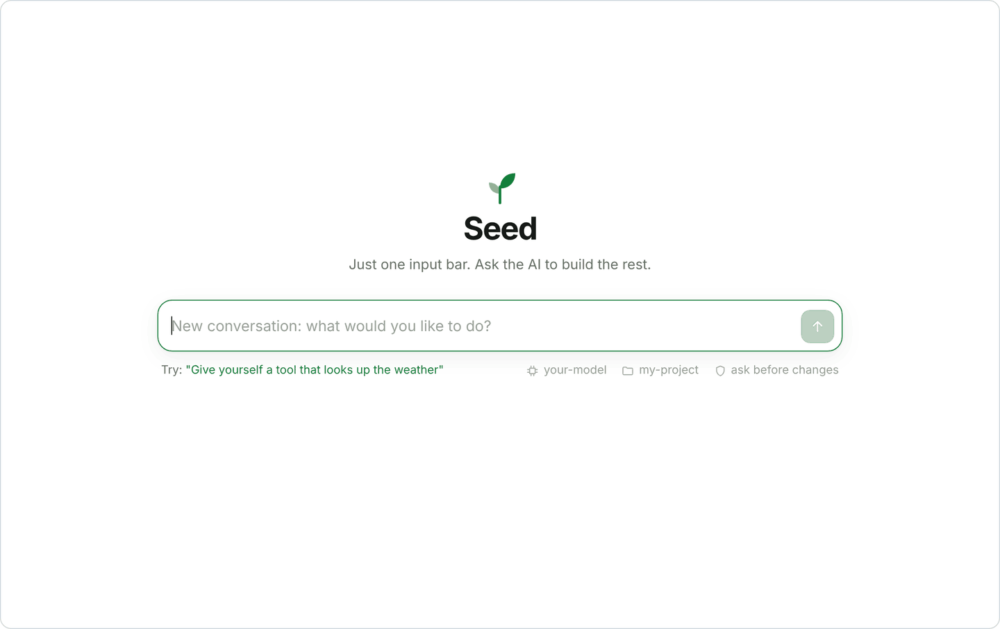
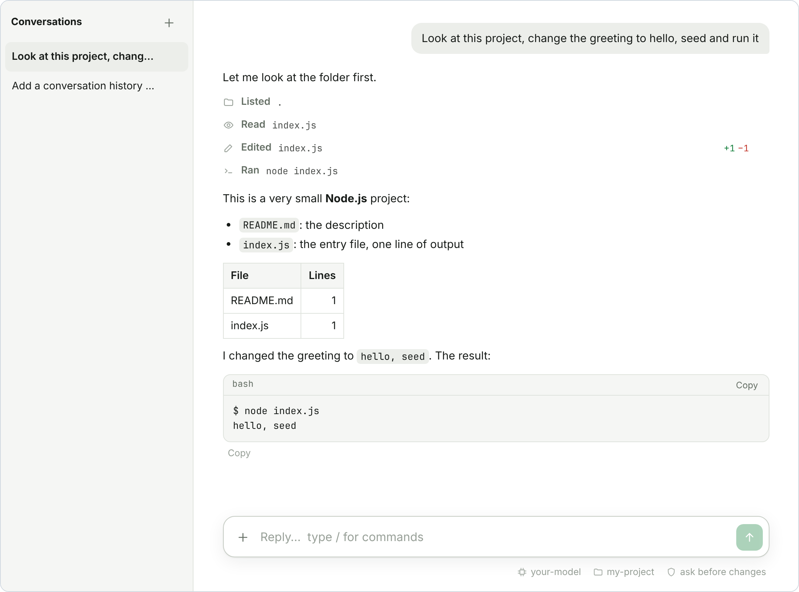
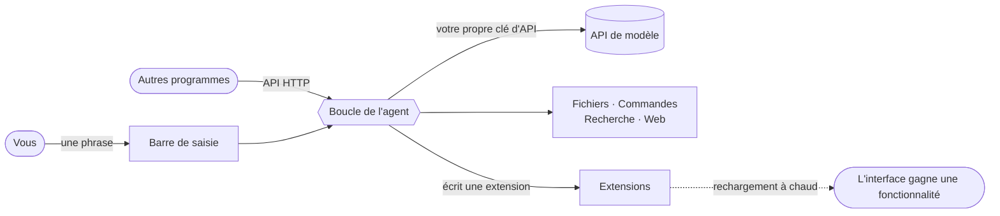
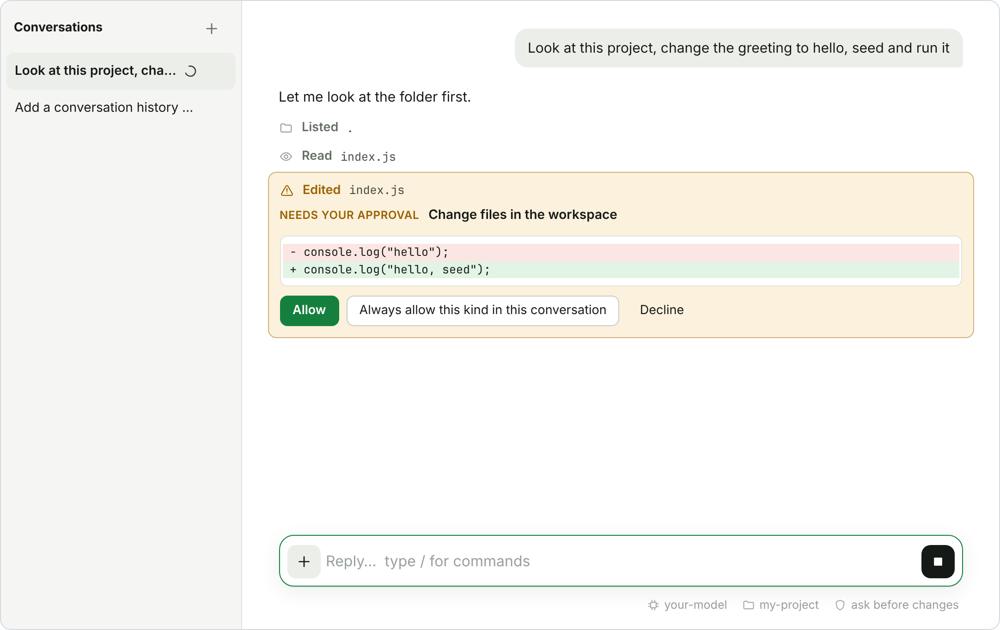

<div align="center">


# Seed

**Un agent IA qui se résume à une barre de saisie. Tout le reste, c'est l'IA qui le construit.**

[简体中文](README.md) · [English](README.en.md) · [日本語](README.ja.md) · **Français** · [Русский](README.ru.md)

<p>
<a href="https://github.com/HolyGr41L1337/Seed/actions/workflows/ci.yml"></a>


</p>

<p>
<a href="https://github.com/HolyGr41L1337/Seed/releases/latest"></a>
&nbsp;
<a href="https://github.com/HolyGr41L1337/Seed/releases/latest"></a>
&nbsp;
<a href="https://github.com/HolyGr41L1337/Seed/releases/latest"></a>
</p>

[Téléchargement](#téléchargement) · [Connecter un modèle](#connecter-une-api-de-modèle) · [Fonctionnalités par l'IA](#laisser-lia-ajouter-des-fonctionnalités) · [API](#utiliser-seed-via-lapi) · [Documentation](#documentation-et-développement)

</div>

<br>

Seed est un environnement d'exécution pour agent (un « harness ») dans l'esprit de Codex et de DeepSeek Harness : branchez votre propre API de modèle, et il lit et écrit des fichiers, exécute des commandes, cherche dans le code et mène des tâches à bien sur votre ordinateur.

La différence, c'est l'interface : au départ, elle se réduit à une barre de nouvelle conversation. Barre latérale d'historique, page de réglages, thèmes, nouveaux outils, intégrations : rien de tout cela n'est fourni d'origine. Vous demandez à l'IA, en une phrase, de l'ajouter à l'application elle-même, et la page s'enrichit sur-le-champ, sans redémarrage.

<div align="center">
<picture>
  <source media="(prefers-color-scheme: dark)" srcset="docs/images/demo-en-dark.gif">
  
</picture>
<br>
<sub>Dites-lui « Ajoute une barre latérale d'historique des conversations à cette application » : l'IA écrit une extension et la barre latérale apparaît aussitôt.<br>Enregistré dans la vraie application ; les réponses du modèle sont scénarisées (interface affichée en anglais).</sub>
</div>

## Fonctionnalités

<table>
<tr>
<td width="50%" valign="top">

**🤖 Un agent complet**

Réponses en streaming, réflexion visible, appels d'outils (shell, lecture, écriture et modification de fichiers, liste de dossiers, glob, grep, récupération de pages web, plan de tâches), approbation action par action, arrêt à tout moment, résumé automatique des longues conversations, prise en compte du fichier `AGENTS.md` du dossier de travail.

</td>
<td width="50%" valign="top">

**🌱 Il grandit tout seul**

L'IA écrit chaque nouvelle fonctionnalité sous forme d'extension (de simples fichiers JavaScript), rechargée à chaud dès l'enregistrement. Si le chargement échoue, l'erreur revient directement à l'IA avec le nom du fichier et le numéro de ligne, et elle corrige jusqu'à ce que cela fonctionne.

</td>
</tr>
<tr>
<td width="50%" valign="top">

**🔌 Votre propre API de modèle**

DeepSeek, OpenAI, OpenRouter, Ollama et tout point d'accès compatible OpenAI ; Claude via le SDK officiel d'Anthropic. Configurez plusieurs fournisseurs et changez à tout moment, même en pleine conversation.

</td>
<td width="50%" valign="top">

**🧩 Pilotable par d'autres programmes**

Toutes les fonctions sont accessibles par une API HTTP. Il existe aussi un point d'accès compatible OpenAI : pointez n'importe quel client OpenAI vers Seed et utilisez l'agent entier comme s'il s'agissait d'un « modèle ».

</td>
</tr>
</table>

Voici à quoi ressemble une tâche de programmation ordinaire : la lecture de fichiers ne demande aucune autorisation, les modifications et les commandes demandent d'abord votre accord, et vous recevez un résumé à la fin.

<div align="center">
<picture>
  <source media="(prefers-color-scheme: dark)" srcset="docs/images/chat-en-dark.png">
  
</picture>
</div>

## Fonctionnement



## Téléchargement

Sur la page [Releases](https://github.com/HolyGr41L1337/Seed/releases/latest), cliquez sous **Assets** sur le fichier qui correspond à votre système :

| Système | Fichier | Installation |
| --- | --- | --- |
| macOS (puce Apple : M1/M2/M3/M4…) | `Seed-<version>-mac-arm64.dmg` | Ouvrez-le et glissez Seed dans Applications |
| macOS (Intel) | `Seed-<version>-mac-x64.dmg` | Idem |
| Windows (la plupart des PC) | `Seed-Setup-<version>-x64.exe` | Double-cliquez pour installer ; l'application s'ouvre ensuite. Aucun droit d'administrateur requis |
| Windows (sans installation) | `Seed-<version>-win-x64.zip` | Décompressez, puis double-cliquez sur `Seed.exe` |
| Windows (PC ARM) | `Seed-Setup-<version>-arm64.exe` | Double-cliquez pour installer |
| Linux | `Seed-<version>-linux-x86_64.AppImage` | Rendez-le exécutable, puis double-cliquez |

Vous ne savez pas quelle puce équipe votre Mac ? Ouvrez le menu Apple → « À propos de ce Mac ». « Puce : Apple M… » correspond à arm64 ; « Processeur : Intel » correspond à x64.

L'application s'ouvre sur une fenêtre réduite à la barre de saisie, avec en dessous une carte « Connect a model API » : choisissez un fournisseur, saisissez votre clé d'API, cliquez sur « Connect », et c'est prêt.

> [!IMPORTANT]
> Les installeurs ne sont pas encore signés avec les certificats payants d'Apple et de Microsoft ; le système bloque donc le premier lancement. Effectuez une seule fois la manipulation ci-dessous, et l'application s'ouvrira ensuite normalement.

- **macOS** : si un message indique que le développeur ne peut pas être vérifié, ou qu'Apple n'a pas pu vérifier l'absence de logiciel malveillant, cliquez sur « Terminé ». Ouvrez ensuite « Réglages Système → Confidentialité et sécurité », repérez en bas de page le message concernant Seed et cliquez sur « Ouvrir quand même ». Vous pouvez aussi exécuter une fois cette commande dans le Terminal :

  ```bash
  xattr -dr com.apple.quarantine /Applications/Seed.app
  ```

- **Windows** : si « Windows a protégé votre ordinateur » s'affiche, cliquez sur « Informations complémentaires », puis sur « Exécuter quand même ». Si le blocage vient du Contrôle intelligent des applications et qu'il n'y a pas de bouton « Exécuter quand même », désactivez cette fonction dans « Sécurité Windows → Contrôle des applications et du navigateur », puis installez.

<details>
<summary><b>Application de bureau : menus et comportement</b></summary>

<br>

- **File → Open Folder…** (`Cmd/Ctrl+O`) : le dossier dans lequel l'IA lit et écrit des fichiers et exécute des commandes. Par défaut, c'est votre dossier personnel ; mieux vaut choisir un projet précis.
- **File → Copy API Connection Info** : copie l'adresse locale de l'API et le jeton d'accès, pour y connecter d'autres programmes (voir [Utiliser Seed via l'API](#utiliser-seed-via-lapi)).
- **View → Safe Mode** : quand une extension a cassé l'interface, ouvre une fenêtre qui ne charge aucune extension d'interface.

L'application de bureau utilise automatiquement les réglages de proxy du système (par exemple un proxy système activé par un outil de proxy) : aucun réglage supplémentaire n'est nécessaire pour joindre OpenAI, Anthropic et les autres services. Sur macOS, l'application continue de tourner après la fermeture de la fenêtre (l'API reste disponible) ; cliquez sur son icône dans le Dock pour rouvrir la fenêtre, et quittez complètement avec `Cmd+Q`.

L'application de bureau et la version en ligne de commande partagent les mêmes données (`~/.seed`) : conversations, réglages et extensions sont communs.

</details>

## Connecter une API de modèle

Le plus simple est de passer par la carte de connexion de l'application (tapez `/connect` pour la rouvrir à tout moment). Vous pouvez aussi définir des variables d'environnement avant le lancement ; Seed les détecte automatiquement :

| Variable d'environnement | Fournisseur |
| --- | --- |
| `ANTHROPIC_API_KEY` | Claude (Anthropic) |
| `DEEPSEEK_API_KEY` | DeepSeek |
| `OPENAI_API_KEY` (avec `OPENAI_BASE_URL` en option) | OpenAI |
| `OPENROUTER_API_KEY` | OpenRouter |

Pour tout autre fournisseur, choisissez « Custom (OpenAI-compatible) » ou « Custom (Anthropic-compatible) » dans la carte de connexion, puis saisissez l'URL de base, la clé et le nom du modèle.

Pour changer de modèle, tapez `/model` et choisissez dans la liste, ou tapez `/model deepseek/deepseek-reasoner`.

<details>
<summary><b>Le fichier de configuration en détail</b></summary>

<br>

Les réglages sont enregistrés dans `~/.seed/config.json` (droits 600 ; les clés restent sur votre ordinateur). Un fournisseur décrit en entier :

```json
{
  "providers": {
    "deepseek": {
      "type": "openai",
      "baseURL": "https://api.deepseek.com",
      "apiKey": "$DEEPSEEK_API_KEY",
      "params": { "max_tokens": 8192 },
      "contextWindow": 128000
    }
  },
  "model": "deepseek/deepseek-chat"
}
```

- `apiKey` peut contenir la clé elle-même ou `"$NOM_DE_VARIABLE"` ; dans ce cas, la clé n'est jamais écrite sur le disque.
- `params` est fusionné tel quel dans chaque requête. Les options propres à un fournisseur (`temperature`, `reasoning_effort`, `thinking` chez DeepSeek, etc.) se placent ici.
- `contextWindow` est la longueur de contexte du modèle. Quand une conversation s'en approche, Seed demande au modèle de résumer ce qui précède, puis continue.
- Certains modèles, comme ceux de DeepSeek, exigent en mode réflexion que le `reasoning_content` précédent soit renvoyé. Seed s'en charge, et bascule automatiquement pour les points d'accès qui ne l'acceptent pas.
- Claude passe par le SDK officiel. Le modèle par défaut est `claude-opus-5-5`, avec la réflexion adaptative et le cache de prompts activés. Pour les modèles qui le permettent, le **repli côté serveur** est lui aussi activé par défaut (si un classifieur de sécurité bloque une requête par erreur, un autre modèle recommandé par Anthropic répond à sa place). Pour le désactiver, ajoutez `"fallbacks": false` aux `params` de ce fournisseur. `params` accepte aussi `effort` (de `low` à `max`) et `maxTokens`.
- Si vous avez besoin d'un proxy, définissez `HTTPS_PROXY` comme d'habitude ; Seed en tient compte.

</details>

## Laisser l'IA ajouter des fonctionnalités

Il suffit de le dire :

- « Ajoute une barre latérale d'historique des conversations à cette application »
- « Ajoute une page de réglages pour changer de modèle et de mode d'approbation »
- « Ajoute un bouton pour basculer entre thème sombre et thème clair »
- « Donne-toi un outil pour consulter la météo »
- « Ajoute un bouton de lecture à voix haute sous chaque réponse »

L'IA commence par lire [docs/EXTENDING.md](docs/EXTENDING.md), écrit l'extension dans `~/.seed/extensions/<nom>/`, appelle `reload_extensions` pour vérifier le chargement, regarde la vraie page avec `ui_eval`, puis, quand tout fonctionne, vous explique comment vous en servir.

Les extensions peuvent ajouter des éléments d'interface (barres latérales, panneaux, boutons, vues pleine page, commandes slash, raccourcis clavier) comme des capacités côté serveur (nouveaux outils pour l'IA, points d'accès HTTP, hooks, tâches planifiées, nouveaux types d'API de modèle).

- Tapez `/extensions` pour afficher, désactiver ou supprimer des extensions.
- Si une extension casse l'interface, tapez `/safe` (ou ajoutez `?safe=1` à l'adresse) pour ouvrir la page sans extensions d'interface, puis demandez à l'IA de réparer. `seed --safe` démarre sans aucune extension.
- [examples/extensions/](examples/extensions/) contient trois exemples complets : une barre latérale d'historique, un sélecteur de thème et une mémoire partagée entre conversations. Pour en utiliser un tel quel, copiez son dossier dans `~/.seed/extensions/`.

> [!NOTE]
> Le code d'une extension dispose de tous les droits (une extension d'interface peut appeler toute l'API ; une extension côté serveur peut faire tout ce que permet Node.js). L'écriture de fichiers d'extension constitue donc une catégorie d'approbation à part : dans tous les modes sauf `full`, Seed vous demande d'abord votre accord.

## Modes d'approbation

Avant toute action ayant des conséquences, l'IA vous demande votre accord. La carte propose trois choix : « Allow » (autoriser), « Always allow this kind in this conversation » (toujours autoriser ce type d'action dans cette conversation) et « Decline » (refuser).

<div align="center">
<picture>
  <source media="(prefers-color-scheme: dark)" srcset="docs/images/approval-en-dark.png">
  
</picture>
</div>

| Mode | Comportement |
| --- | --- |
| `ask` (par défaut) | La lecture des fichiers du dossier de travail ne demande aucune autorisation. L'exécution de commandes, la modification de fichiers, l'accès au réseau et la modification des réglages de l'application demandent tous votre accord. Quelques commandes en lecture seule (`ls`, `cat`, `git status`, etc.) s'exécutent sans demander. |
| `auto-edit` | Les modifications de fichiers dans le dossier de travail sont autorisées automatiquement ; pour le reste, comme ci-dessus. |
| `full` | Tout est autorisé. |

Changez de mode avec `/mode`. Après un refus, l'IA s'arrête et attend vos instructions ; elle ne cherche pas à contourner.

## Utiliser Seed via l'API

Le jeton d'accès s'affiche au démarrage, et `seed url` permet de le revoir à tout moment. Dans l'application de bureau, utilisez le menu File → Copy API Connection Info.

**Comme un point d'accès OpenAI** (URL de base `http://127.0.0.1:7333/v1`, le jeton d'accès comme clé d'API, modèle `seed`) :

```python
from openai import OpenAI

client = OpenAI(base_url="http://127.0.0.1:7333/v1", api_key="<jeton d'accès>")
reply = client.chat.completions.create(
    model="seed",
    messages=[{"role": "user", "content": "Quels TODO y a-t-il dans ce dépôt ?"}],
)
print(reply.choices[0].message.content)
```

Par cette voie, personne ne peut cliquer sur une approbation ; par défaut, seule la lecture est donc permise. Pour le laisser agir, envoyez l'en-tête de requête `x-seed-approval: auto-edit` ou `full`.

**Un appel, une tâche accomplie** :

```bash
curl http://127.0.0.1:7333/api/chat \
  -H "Authorization: Bearer <jeton d'accès>" -H "Content-Type: application/json" \
  -d '{"message": "Lance les tests et résume pourquoi ils échouent", "approval": "full"}'
```

Ajoutez `"stream": true` pour recevoir un flux d'événements en direct. Conversations, approbations, réglages, extensions, abonnement aux événements et tout le reste sont décrits dans [docs/API.md](docs/API.md) (en anglais).

## Commandes

Tapez `/` dans la barre de saisie pour ouvrir le menu des commandes :

| Commande | Rôle |
| --- | --- |
| `/new` | Commencer une nouvelle conversation |
| `/connect` | Connecter une API de modèle ou en changer |
| `/model [fournisseur/modèle]` | Afficher le modèle ou en changer |
| `/mode [ask\|auto-edit\|full]` | Changer de mode d'approbation |
| `/cd <dossier>` | Changer de dossier de travail |
| `/compact` | Résumer le début de la conversation |
| `/extensions` | Afficher et gérer les extensions |
| `/stop` | Arrêter la tâche en cours |
| `/safe` | Rouvrir la page en mode sans échec |
| `/help` | Afficher toutes les commandes (y compris celles ajoutées par des extensions) |

<details>
<summary><b>Ligne de commande</b></summary>

<br>

```bash
seed                        # démarrer (interface + API)
seed --port 8080 --cwd ~/code/app
seed exec "corrige les tests en échec"   # sans interface : exécuter une tâche dans le terminal
seed exec --approval full --json "…"     # pour les scripts : tout autoriser, un événement JSON par ligne
seed url                    # afficher l'adresse avec le jeton
seed --safe                 # démarrer sans extensions
```

La version en ligne de commande s'installe depuis les sources ; voir [Documentation et développement](#documentation-et-développement).

</details>

## Sécurité

> [!WARNING]
> **Il n'y a pas de bac à sable au niveau du système d'exploitation.** La sécurité repose sur les approbations : dans le mode par défaut, les commandes et les modifications demandent votre accord. Le mode `full` revient à confier votre ordinateur au modèle ; ne l'utilisez que si vous avez confiance dans la tâche.

- Par défaut, le serveur n'écoute que sur cet ordinateur (`127.0.0.1`). Tous les points d'accès exigent le jeton d'accès. La session du navigateur ne vaut que pour la page de Seed, et les autres sites web ne peuvent pas s'en servir. Quand la page est intégrée dans un IDE ou dans un volet d'aperçu cloud où les cookies ne fonctionnent pas, elle se connecte avec le jeton.
- Les outils de fichiers n'ouvrent pas `~/.seed/config.json` (vos clés s'y trouvent), et les réglages renvoyés par l'API ne contiennent jamais de clé.
- La sortie du modèle est traitée comme non fiable : l'interface n'en affiche pas le HTML, ne charge pas automatiquement les images distantes, et seuls les liens http(s) et mailto sont cliquables.
- Si vous l'ouvrez au réseau avec `--host 0.0.0.0`, le jeton est le seul verrou. Ajoutez vous-même HTTPS et un pare-feu.

## Limites actuelles

- Les adaptateurs de modèles ont été écrits d'après les protocoles publics et vérifiés avec des serveurs simulés. L'environnement de développement ne disposait d'aucune vraie clé d'API : **ils n'ont donc pas encore été testés avec les vraies API de DeepSeek, d'OpenAI et d'Anthropic**. Si un fournisseur présente une exigence particulière à la première utilisation, elle se règle le plus souvent dans les `params` de ce fournisseur.
- Pas de bac à sable au niveau du système (voir ci-dessus).
- MCP, la recherche web et une interface d'envoi d'images ne sont pas encore intégrés (l'API accepte déjà les blocs de contenu image). L'IA peut les ajouter sous forme d'extensions.
- Les tests automatisés et le test de fumée de l'application de bureau tournent sous Linux, macOS et Windows (GitHub Actions), mais l'application n'a pas encore connu d'usage prolongé sur les Mac et les PC Windows de vrais utilisateurs.
- L'interface existe pour l'instant en chinois et en anglais, selon la langue du système. Les images de cette page montrent l'interface en anglais.

## Documentation et développement

| Document | Contenu |
| --- | --- |
| [docs/EXTENDING.md](docs/EXTENDING.md) | Référence des extensions (en anglais). C'est ce que lit l'IA quand elle ajoute une fonctionnalité |
| [docs/API.md](docs/API.md) | Référence de l'API HTTP (en anglais) |
| [docs/ARCHITECTURE.md](docs/ARCHITECTURE.md) | Comment les différentes parties s'articulent, et pourquoi les choix de conception clés sont ce qu'ils sont (en chinois) |
| [docs/DEVELOPMENT.md](docs/DEVELOPMENT.md) | Exécution depuis les sources, structure du projet, tests, publication, signature des installeurs (en chinois) |

L'exécution depuis les sources nécessite Node.js 22 ou une version ultérieure :

```bash
npm install
npm run desktop   # l'application de bureau
npm start         # un serveur web local, à utiliser dans le navigateur
```

La seule dépendance d'exécution est `@anthropic-ai/sdk` (l'application de bureau utilise en plus Electron). Il n'y a pas d'étape de compilation : modifiez le code et redémarrez.
