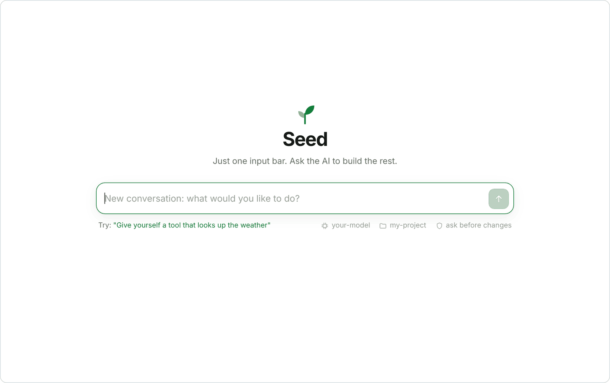
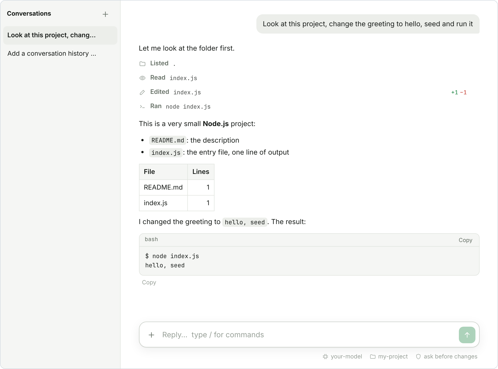
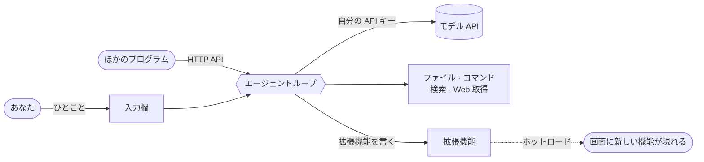
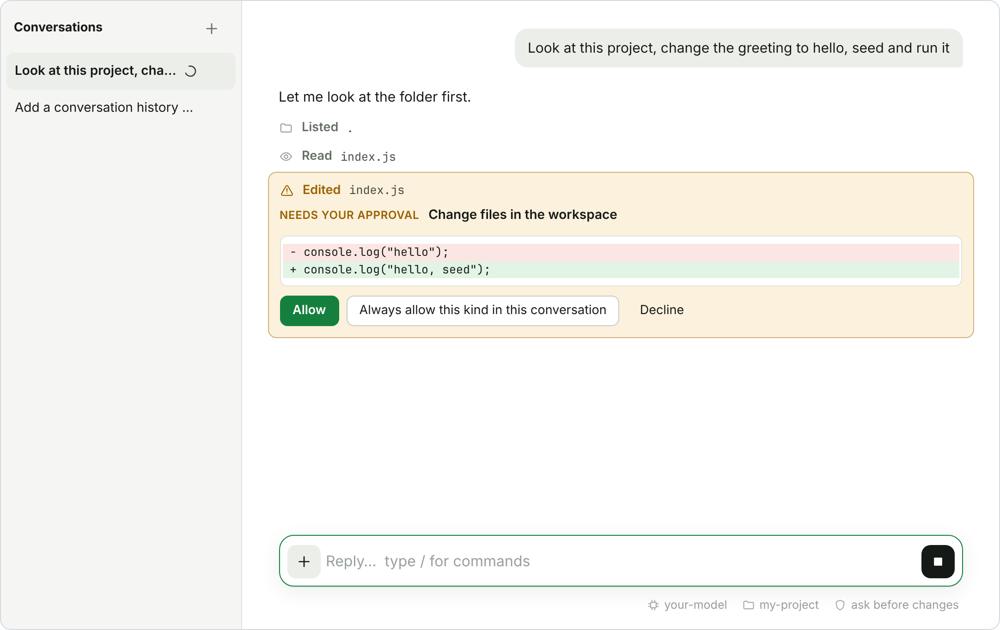

<div align="center">


# Seed

**入力欄ひとつだけの AI エージェント。ほかの機能は、AI に作らせる。**

[简体中文](README.md) · [English](README.en.md) · **日本語** · [Français](README.fr.md) · [Русский](README.ru.md)

<p>
<a href="https://github.com/HolyGr41L1337/Seed/actions/workflows/ci.yml"></a>


</p>

<p>
<a href="https://github.com/HolyGr41L1337/Seed/releases/latest"></a>
&nbsp;
<a href="https://github.com/HolyGr41L1337/Seed/releases/latest"></a>
&nbsp;
<a href="https://github.com/HolyGr41L1337/Seed/releases/latest"></a>
</p>

[ダウンロード](#ダウンロードとインストール) · [モデル API に接続する](#モデル-api-に接続する) · [AI に機能を追加させる](#ai-に機能を追加させる) · [API から利用する](#api-から利用する) · [ドキュメント](#ドキュメントと開発)

</div>

<br>

Seed は、Codex や DeepSeek Harness のようなエージェント実行環境（ハーネス）です。自分のモデル API をつなぐだけで、あなたのコンピューター上でファイルの読み書き、コマンドの実行、コードの検索を行い、タスクをこなします。

違うのは画面です。最初にあるのは、新しい会話を始める入力欄ひとつだけ。履歴サイドバーも、設定ページも、テーマも、新しいツールも、各種連携も、最初からは入っていません。ひとこと頼めば AI がこのアプリ自体に追加し、再起動なしで、その場で画面に現れます。

<div align="center">
<picture>
  <source media="(prefers-color-scheme: dark)" srcset="docs/images/demo-en-dark.gif">
  
</picture>
<br>
<sub>「このアプリに会話履歴のサイドバーを追加して」と頼むと、AI が拡張機能を書き、その場でサイドバーが現れます。<br>実際のアプリを録画したものです。モデルの応答はあらかじめ用意したスクリプトです（画面は英語表示）。</sub>
</div>

## 特長

<table>
<tr>
<td width="50%" valign="top">

**🤖 ひととおり揃ったエージェント**

ストリーミング応答、思考過程の表示、ツール呼び出し（シェル、ファイルの読み取り・書き込み・編集、ディレクトリ一覧、glob、grep、Web ページの取得、タスク計画）、操作ごとの承認、いつでも停止、長い会話の自動要約、作業フォルダーの `AGENTS.md` の読み込み。

</td>
<td width="50%" valign="top">

**🌱 自分で育つ**

AI は新しい機能を拡張機能（素の JavaScript ファイル）として書き、保存した時点でホットロードされます。読み込みに失敗すると、ファイル名と行番号つきのエラーがそのまま AI に返り、動くまで AI が自分で直します。

</td>
</tr>
<tr>
<td width="50%" valign="top">

**🔌 自分のモデル API をつなぐ**

DeepSeek、OpenAI、OpenRouter、Ollama のほか、OpenAI 互換のエンドポイントならどれでも使えます。Claude は Anthropic 公式 SDK 経由です。複数のプロバイダーを登録して、会話の途中でもいつでも切り替えられます。

</td>
<td width="50%" valign="top">

**🧩 ほかのプログラムからも使える**

すべての機能に HTTP API があります。OpenAI 互換のエンドポイントもあり、OpenAI 対応クライアントの接続先を Seed にするだけで、エージェント全体をひとつの「モデル」として使えます。

</td>
</tr>
</table>

ふつうのコーディング作業はこんな流れです。ファイルの読み取りは確認なし、ファイルの変更とコマンドの実行は先に確認、終わったら要約を返します。

<div align="center">
<picture>
  <source media="(prefers-color-scheme: dark)" srcset="docs/images/chat-en-dark.png">
  
</picture>
</div>

## 仕組み



## ダウンロードとインストール

[Releases](https://github.com/HolyGr41L1337/Seed/releases/latest) ページの **Assets** で、お使いの環境に合ったファイル名をクリックするとダウンロードできます。

| OS | ファイル | 使い方 |
| --- | --- | --- |
| macOS（Apple シリコン：M1/M2/M3/M4…） | `Seed-<バージョン>-mac-arm64.dmg` | 開いて Seed を「アプリケーション」にドラッグ |
| macOS（Intel） | `Seed-<バージョン>-mac-x64.dmg` | 同上 |
| Windows（ほとんどの PC） | `Seed-Setup-<バージョン>-x64.exe` | ダブルクリックでインストール。完了すると自動で起動します。管理者権限は不要です |
| Windows（インストール不要） | `Seed-<バージョン>-win-x64.zip` | 展開して `Seed.exe` をダブルクリック |
| Windows（ARM 搭載 PC） | `Seed-Setup-<バージョン>-arm64.exe` | ダブルクリックでインストール |
| Linux | `Seed-<バージョン>-linux-x86_64.AppImage` | 実行権限を付けてダブルクリック |

Mac のチップがわからないときは、アップルメニュー →「この Mac について」を開きます。「チップ」に Apple M… とあれば arm64、「プロセッサ」に Intel とあれば x64 です。

起動すると、入力欄だけのウインドウと、その下にモデル API の接続カード（Connect a model API）が表示されます。プロバイダーを選び、API キーを入力して「Connect」を押せば使い始められます。

> [!IMPORTANT]
> インストーラーには、Apple と Microsoft の有料の署名がまだありません。そのため、初回の起動時にシステムの警告が出ます。以下の操作を一度行えば、次からはふつうに開けます。

- **macOS**：「開発元を検証できません」や「Apple は、マルウェアが含まれていないことを検証できませんでした」と表示されたら、「完了」を押して閉じます。次に「システム設定 → プライバシーとセキュリティ」を開き、ページ下部にある Seed についての表示で「このまま開く」を押します。「ターミナル」で次のコマンドを一度実行する方法もあります。

  ```bash
  xattr -dr com.apple.quarantine /Applications/Seed.app
  ```

- **Windows**：「Windows によって PC が保護されました」と表示されたら、「詳細情報」→「実行」の順にクリックします。スマート アプリ コントロールによるブロックで「実行」ボタンがない場合は、「Windows セキュリティ → アプリとブラウザー コントロール」でこの機能をオフにしてからインストールしてください。

<details>
<summary><b>デスクトップ版のメニューと動作</b></summary>

<br>

- **File → Open Folder…**（`Cmd/Ctrl+O`）：AI がファイルを読み書きし、コマンドを実行するフォルダーです。既定はホームフォルダーなので、具体的なプロジェクトを選ぶことをおすすめします。
- **File → Copy API Connection Info**：ローカルの API アドレスとアクセストークンをコピーします。ほかのプログラムから接続するときに使います（[API から利用する](#api-から利用する)を参照）。
- **View → Safe Mode**：拡張機能が画面を壊してしまったときに、UI 拡張機能を読み込まないウインドウを開きます。

デスクトップ版はシステムのプロキシ設定を自動的に使います（プロキシツールが有効にしたシステムプロキシなど）。OpenAI や Anthropic などのサービスに接続するための追加設定は不要です。macOS ではウインドウを閉じてもアプリはバックグラウンドで動き続け（API も引き続き使えます）、Dock のアイコンをクリックするとウインドウが開き直します。完全に終了するには `Cmd+Q` を押します。

デスクトップ版とコマンドライン版は同じデータ（`~/.seed`）を使います。会話、設定、拡張機能は共通です。

</details>

## モデル API に接続する

アプリ内の接続カードを使うのがいちばん簡単です（`/connect` と入力すればいつでも開き直せます）。起動前に環境変数を設定しておけば、Seed が自動的に認識します。

| 環境変数 | プロバイダー |
| --- | --- |
| `ANTHROPIC_API_KEY` | Claude（Anthropic） |
| `DEEPSEEK_API_KEY` | DeepSeek |
| `OPENAI_API_KEY`（`OPENAI_BASE_URL` も指定可） | OpenAI |
| `OPENROUTER_API_KEY` | OpenRouter |

そのほかのプロバイダーは、接続カードで「Custom (OpenAI-compatible)」または「Custom (Anthropic-compatible)」を選び、ベース URL、キー、モデル名を入力します。

モデルを切り替えるには、`/model` と入力して一覧から選ぶか、`/model deepseek/deepseek-reasoner` のように指定します。

<details>
<summary><b>設定ファイルの書き方</b></summary>

<br>

設定は `~/.seed/config.json` に保存されます（パーミッション 600。キーはこのコンピューターの中だけに保存されます）。プロバイダーをすべて書くと次のようになります。

```json
{
  "providers": {
    "deepseek": {
      "type": "openai",
      "baseURL": "https://api.deepseek.com",
      "apiKey": "$DEEPSEEK_API_KEY",
      "params": { "max_tokens": 8192 },
      "contextWindow": 128000
    }
  },
  "model": "deepseek/deepseek-chat"
}
```

- `apiKey` にはキーそのものを書くことも、`"$環境変数名"` と書くこともできます。後者ならキーはディスクに保存されません。
- `params` はすべてのリクエストにそのまま加えられます。プロバイダー固有のスイッチ（`temperature`、`reasoning_effort`、DeepSeek の `thinking` など）はここに書きます。
- `contextWindow` はモデルのコンテキスト長です。会話がこの長さに近づくと、Seed はモデルにそれまでの内容を要約させてから続けます。
- DeepSeek などのモデルは、思考モードではそれまでの `reasoning_content` を送り返す必要があります。Seed はこれを自動で行い、送り返しを受け付けないエンドポイントでは自動的に切り替えます。
- Claude は公式 SDK を使います。既定のモデルは `claude-opus-5-5` で、アダプティブ思考とプロンプトキャッシュが有効です。対応するモデルでは**サーバー側フォールバック**も既定で有効です（安全性分類器がリクエストを誤ってブロックしたとき、Anthropic が推奨する別のモデルが代わりに回答します）。不要な場合は、そのプロバイダーの `params` に `"fallbacks": false` を追加してください。`params` では `effort`（`low` から `max`）と `maxTokens` も指定できます。
- プロキシが必要な場合は、いつもどおり `HTTPS_PROXY` を設定してください。Seed はそれに従います。

</details>

## AI に機能を追加させる

そのまま言うだけです。

- 「このアプリに会話履歴のサイドバーを追加して」
- 「モデルと承認モードを切り替えられる設定ページを追加して」
- 「ダーク／ライトのテーマ切り替えボタンを追加して」
- 「天気を調べるツールを自分に追加して」
- 「回答ごとに読み上げボタンを付けて」

AI はまず [docs/EXTENDING.md](docs/EXTENDING.md) を読み、`~/.seed/extensions/<名前>/` に拡張機能を書き、`reload_extensions` を呼んで読み込み結果を確かめ、`ui_eval` で実際の画面を確認します。問題がなければ、使い方を教えてくれます。

拡張機能は、画面の要素（サイドバー、パネル、ボタン、全画面ビュー、スラッシュコマンド、キーボードショートカット）も、バックエンドの機能（AI が使う新しいツール、HTTP エンドポイント、フック、定期実行ジョブ、新しい種類のモデル API）も追加できます。

- `/extensions` と入力すると、拡張機能の一覧表示、無効化、削除ができます。
- 拡張機能が画面を壊してしまったら、`/safe` と入力する（またはアドレスの末尾に `?safe=1` を付ける）と、UI 拡張機能を読み込まずにページを開けます。そのうえで AI に直してもらいましょう。`seed --safe` で起動すると、拡張機能をいっさい読み込みません。
- [examples/extensions/](examples/extensions/) に完成したサンプルが 3 つあります（履歴サイドバー、テーマ切り替え、会話をまたぐメモリ）。そのまま使うには、フォルダーを `~/.seed/extensions/` にコピーしてください。

> [!NOTE]
> 拡張機能のコードはすべての権限を持ちます（UI 拡張機能は API をすべて呼び出せ、バックエンド拡張機能は Node.js でできることなら何でもできます）。そのため、拡張機能ファイルの書き込みは独立した承認カテゴリになっていて、`full` モード以外では必ず先に確認します。

## 承認モード

影響のある操作をする前に、AI はあなたに確認します。カードには「Allow」（許可）、「Always allow this kind in this conversation」（この会話ではこの種類の操作を常に許可）、「Decline」（拒否）の 3 つの選択肢があります。

<div align="center">
<picture>
  <source media="(prefers-color-scheme: dark)" srcset="docs/images/approval-en-dark.png">
  
</picture>
</div>

| モード | 動作 |
| --- | --- |
| `ask`（既定） | 作業フォルダー内のファイルの読み取りは確認なし。コマンドの実行、ファイルの変更、ネットワークへのアクセス、アプリの設定変更は、すべてあなたの同意が必要です。一部の読み取り専用コマンド（`ls`、`cat`、`git status` など）は確認なしで実行されます。 |
| `auto-edit` | 作業フォルダー内のファイルの変更は自動で許可。そのほかは上と同じです。 |
| `full` | すべて許可します。 |

`/mode` で切り替えます。拒否すると AI は止まってあなたの指示を待ちます。別の方法でやり直そうとはしません。

## API から利用する

アクセストークンは起動時に表示されます。`seed url` を実行すればいつでも確認できます。デスクトップ版ではメニューの File → Copy API Connection Info を使います。

**OpenAI のエンドポイントとして使う**（ベース URL は `http://127.0.0.1:7333/v1`、API キーはアクセストークン、モデルは `seed`）：

```python
from openai import OpenAI

client = OpenAI(base_url="http://127.0.0.1:7333/v1", api_key="<アクセストークン>")
reply = client.chat.completions.create(
    model="seed",
    messages=[{"role": "user", "content": "このリポジトリにはどんな TODO がありますか？"}],
)
print(reply.choices[0].message.content)
```

この方法では承認ボタンを押す人がいないため、既定では読み取りだけが許可されます。操作も任せるには、リクエストヘッダー `x-seed-approval: auto-edit` または `full` を付けてください。

**1 回の呼び出しでタスクを 1 つ完了させる**：

```bash
curl http://127.0.0.1:7333/api/chat \
  -H "Authorization: Bearer <アクセストークン>" -H "Content-Type: application/json" \
  -d '{"message": "テストを実行して、失敗の原因をまとめて", "approval": "full"}'
```

`"stream": true` を付けると、リアルタイムのイベントストリームを受け取れます。会話の管理、承認、設定、拡張機能、イベントの購読など、すべての API は [docs/API.md](docs/API.md)（英語）にあります。

## コマンド

入力欄に `/` と入力すると、コマンドメニューが開きます。

| コマンド | 説明 |
| --- | --- |
| `/new` | 新しい会話を始める |
| `/connect` | モデル API を接続する、または変更する |
| `/model [プロバイダー/モデル]` | モデルを表示する、または切り替える |
| `/mode [ask\|auto-edit\|full]` | 承認モードを切り替える |
| `/cd <フォルダー>` | 作業フォルダーを変更する |
| `/compact` | 会話の古い部分を要約する |
| `/extensions` | 拡張機能を表示・管理する |
| `/stop` | 実行中のタスクを止める |
| `/safe` | セーフモードでページを開き直す |
| `/help` | すべてのコマンドを表示する（拡張機能が追加したものを含む） |

<details>
<summary><b>コマンドライン</b></summary>

<br>

```bash
seed                        # 起動（画面 + API）
seed --port 8080 --cwd ~/code/app
seed exec "失敗しているテストを直して"    # 画面なしで、ターミナルでタスクを 1 つ実行
seed exec --approval full --json "…"   # スクリプト向け：すべて許可し、JSON イベントを 1 行ずつ出力
seed url                    # トークン付きのアドレスを表示
seed --safe                 # 拡張機能を読み込まずに起動
```

コマンドライン版はソースからインストールします。[ドキュメントと開発](#ドキュメントと開発)を参照してください。

</details>

## セキュリティ

> [!WARNING]
> **OS レベルのサンドボックスはありません。** 安全は承認によって守られます。既定のモードでは、コマンドと変更にはあなたの同意が必要です。`full` モードは、コンピューターをモデルに委ねるのと同じです。タスクの内容を信頼できるときだけ使ってください。

- サーバーは既定でこのコンピューター（`127.0.0.1`）でのみ待ち受けます。すべての API にアクセストークンが必要です。ブラウザーのログイン状態は Seed 自身のページでのみ有効で、ほかの Web サイトからは利用できません。IDE やクラウドのプレビューペインに埋め込まれて Cookie が使えない場合は、自動的にトークンでのログインに切り替わります。
- ファイルツールは `~/.seed/config.json`（キーが入っています）を開きません。API が返す設定にもキーは含まれません。
- モデルの出力は信頼できない内容として扱います。画面は出力中の HTML を描画せず、リモート画像を自動で読み込まず、クリックできるリンクは http(s) と mailto だけです。
- `--host 0.0.0.0` で外部に公開する場合、トークンが唯一の鍵になります。HTTPS とファイアウォールはご自身で用意してください。

## 現在の制限

- モデル API のアダプターは、公開されているプロトコルに沿って実装し、モックサーバーで検証しています。開発環境に本物の API キーがなかったため、**実際の DeepSeek / OpenAI / Anthropic の API ではまだ動作確認をしていません**。初めて接続したときにプロバイダー固有の要件に当たった場合は、たいていそのプロバイダーの `params` で調整できます。
- OS レベルのサンドボックスはありません（上記参照）。
- MCP、Web 検索、画像アップロードの画面はまだ内蔵していません（API は画像コンテンツブロックに対応済みです）。いずれも AI に拡張機能として追加させることができます。
- 自動テストとデスクトップアプリのスモークテストは Linux、macOS、Windows で実行しています（GitHub Actions）。ただし、実際の利用者の Mac や Windows PC で長期間使われた実績はまだありません。
- アプリの表示言語は現在、中国語と英語のみです（システムの言語に応じて自動で選ばれます）。このページの画像は英語表示のものです。

## ドキュメントと開発

| ドキュメント | 内容 |
| --- | --- |
| [docs/EXTENDING.md](docs/EXTENDING.md) | 拡張機能のリファレンス（英語）。AI が機能を追加するときに読むのもこれです |
| [docs/API.md](docs/API.md) | HTTP API リファレンス（英語） |
| [docs/ARCHITECTURE.md](docs/ARCHITECTURE.md) | 各部分がどう連携するか、主要な設計がなぜそうなっているか（中国語） |
| [docs/DEVELOPMENT.md](docs/DEVELOPMENT.md) | ソースからの実行、プロジェクト構成、テスト、リリース、インストーラーの署名（中国語） |

ソースから実行するには Node.js 22 以降が必要です。

```bash
npm install
npm run desktop   # デスクトップアプリ
npm start         # ローカルの Web サーバー（ブラウザーで使う）
```

実行時の依存パッケージは `@anthropic-ai/sdk` だけです（デスクトップ版はさらに Electron を使います）。ビルド手順はなく、コードを変更したら再起動するだけです。
