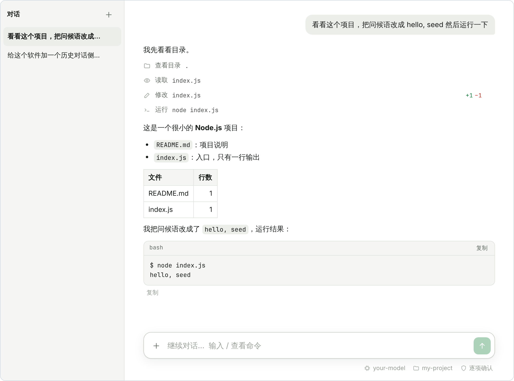
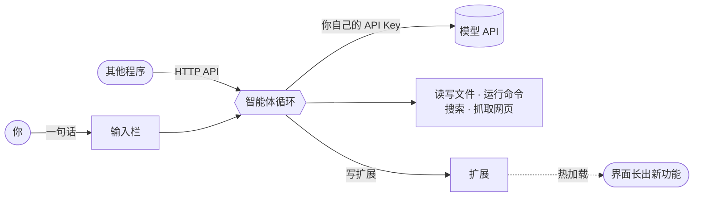
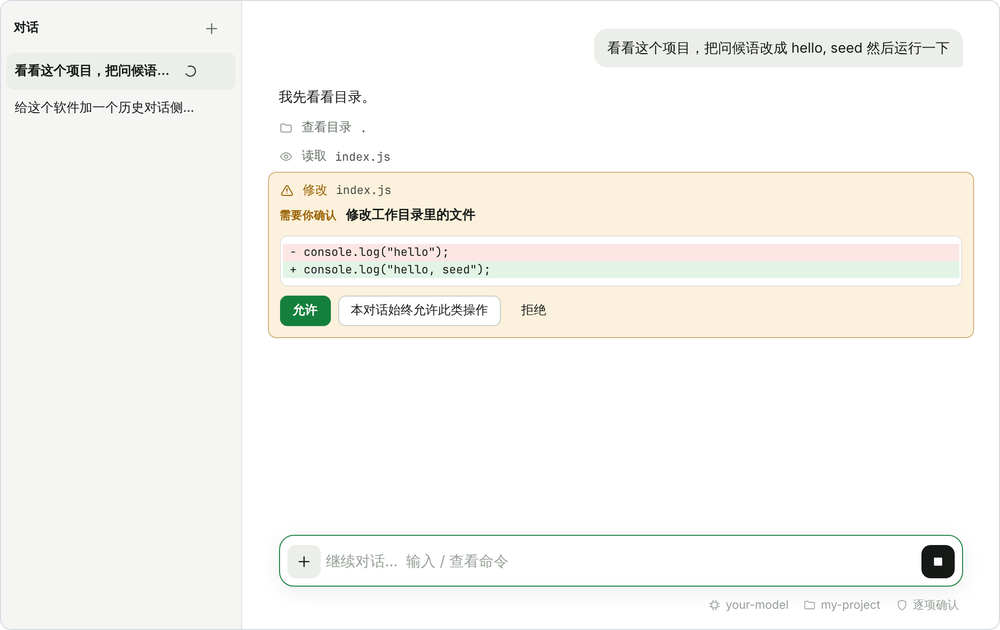

<div align="center">


# Seed

**只有一个输入栏的 AI 智能体工具。其余的功能，让 AI 来做。**

**简体中文** · [English](README.en.md) · [日本語](README.ja.md) · [Français](README.fr.md) · [Русский](README.ru.md)

<p>
<a href="https://github.com/HolyGr41L1337/Seed/actions/workflows/ci.yml"></a>


</p>

<p>
<a href="https://github.com/HolyGr41L1337/Seed/releases/latest"></a>
&nbsp;
<a href="https://github.com/HolyGr41L1337/Seed/releases/latest"></a>
&nbsp;
<a href="https://github.com/HolyGr41L1337/Seed/releases/latest"></a>
</p>

[下载安装](#下载安装) · [连接模型 API](#连接模型-api) · [让 AI 给软件加功能](#让-ai-给软件加功能) · [通过 API 接入](#通过-api-接入) · [文档](#文档与开发)

</div>

<br>

Seed 是一个类似 Codex、DeepSeek Harness 的智能体运行框架（harness）：接上你自己的模型 API，它就能在你的电脑上读写文件、运行命令、搜索代码、完成任务。

不同的地方在于，它的界面一开始只有一个新建对话栏。历史侧边栏、设置页、主题、新工具、各种集成，都不内置。你用一句话让 AI 给软件本身加上，页面当场长出来，不用重启。

<div align="center">
<picture>
  <source media="(prefers-color-scheme: dark)" srcset="docs/images/demo-zh-dark.gif">
  
</picture>
<br>
<sub>对它说“给这个软件加一个历史对话侧边栏”，AI 写出一个扩展，侧边栏当场出现。<br>动图录自真实的应用，其中模型的回复是预先写好的脚本。</sub>
</div>

## 特点

<table>
<tr>
<td width="50%" valign="top">

**🤖 一个完整的智能体**

流式对话、思考过程、工具调用（命令行、读写改文件、目录、glob、grep、抓取网页、任务计划）、逐项审批、随时停止、长对话自动整理上下文、读取工作目录里的 `AGENTS.md`。

</td>
<td width="50%" valign="top">

**🌱 自我生长**

AI 把新功能写成扩展（纯 JavaScript 文件），保存即热加载。加载出错时，带文件名和行号的报错会直接回给 AI，它自己改到好为止。

</td>
</tr>
<tr>
<td width="50%" valign="top">

**🔌 接你自己的模型 API**

DeepSeek、OpenAI、OpenRouter、Ollama 以及任何 OpenAI 兼容接口；Claude 走 Anthropic 官方 SDK。可以配多家，随时切换，同一个对话中途换模型也行。

</td>
<td width="50%" valign="top">

**🧩 别的程序也能接它**

全部功能都有 HTTP API。另有一个 OpenAI 兼容端点，把任何支持 OpenAI 接口的客户端指向 Seed，就能把整个智能体当成一个“模型”来用。

</td>
</tr>
</table>

一次普通的编码任务是这样的：读文件不用问，改文件和运行命令先问你，做完给出总结。

<div align="center">
<picture>
  <source media="(prefers-color-scheme: dark)" srcset="docs/images/chat-zh-dark.png">
  
</picture>
</div>

## 工作方式



## 下载安装

到 [Releases](https://github.com/HolyGr41L1337/Seed/releases/latest) 页面，在 **Assets** 里点对应的文件名即可下载：

| 系统 | 下载 | 用法 |
| --- | --- | --- |
| macOS（Apple 芯片：M1/M2/M3/M4…） | `Seed-<版本>-mac-arm64.dmg` | 打开后把 Seed 拖进“应用程序” |
| macOS（Intel 芯片） | `Seed-<版本>-mac-x64.dmg` | 同上 |
| Windows（绝大多数电脑） | `Seed-Setup-<版本>-x64.exe` | 双击安装，装完自动打开，不需要管理员权限 |
| Windows（免安装） | `Seed-<版本>-win-x64.zip` | 解压后双击 `Seed.exe` |
| Windows（ARM 电脑） | `Seed-Setup-<版本>-arm64.exe` | 双击安装 |
| Linux | `Seed-<版本>-linux-x86_64.AppImage` | 加上执行权限后双击 |

不知道 Mac 是哪种芯片：点左上角苹果菜单 →“关于本机”，“芯片”一栏写着 Apple M… 的选 arm64，写着 Intel 的选 x64。

打开后是一个只有输入栏的窗口，下方有“连接模型 API”的卡片：选服务商，填 API Key，点连接，就可以开始用了。

> [!IMPORTANT]
> 安装包目前没有经过苹果和微软的付费签名，第一次打开时系统会拦一下。按下面操作一次即可，以后正常打开。

- **macOS**：双击后如果提示“无法验证开发者”或“Apple 无法检查其是否包含恶意软件”，先点“完成”关掉提示，然后打开“系统设置 → 隐私与安全性”，在页面下方找到关于 Seed 的提示，点“仍要打开”。也可以在“终端”里运行一次：

  ```bash
  xattr -dr com.apple.quarantine /Applications/Seed.app
  ```

- **Windows**：如果出现“Windows 已保护你的电脑”，点“更多信息”，再点“仍要运行”。如果提示来自“智能应用控制”并且没有“仍要运行”按钮，需要在“Windows 安全中心 → 应用和浏览器控制”里关闭该功能后再安装。

<details>
<summary><b>桌面版的菜单和行为</b></summary>

<br>

- **文件 → 选择工作目录…**（`Cmd/Ctrl+O`）：AI 读写文件、运行命令所在的文件夹。默认是你的用户主目录，建议选到具体项目。
- **文件 → 复制 API 接入信息**：复制本机 API 地址和访问令牌，给别的程序接入用（见[通过 API 接入](#通过-api-接入)）。
- **视图 → 安全模式**：某个扩展把界面弄坏时，用它打开一个不加载界面扩展的窗口。

桌面版会自动使用系统的代理设置（例如代理工具开启的系统代理），访问 OpenAI、Anthropic 等服务时不需要额外配置。macOS 上关闭窗口后应用仍在后台运行（API 也继续可用），从程序坞点它会重新打开窗口；完全退出用 `Cmd+Q`。

桌面版和命令行版共用同一份数据（`~/.seed`），对话、设置和扩展是通用的。

</details>

## 连接模型 API

在界面里连接最简单（随时输入 `/connect` 可以再打开）。也可以在启动前设置环境变量，Seed 会自动识别：

| 环境变量 | 服务商 |
| --- | --- |
| `ANTHROPIC_API_KEY` | Claude（Anthropic） |
| `DEEPSEEK_API_KEY` | DeepSeek |
| `OPENAI_API_KEY`（可配 `OPENAI_BASE_URL`） | OpenAI |
| `OPENROUTER_API_KEY` | OpenRouter |

其他服务商在连接卡片里选“自定义（OpenAI 兼容）”或“自定义（Anthropic 兼容）”，填接口地址、Key 和模型名即可。

切换模型：输入 `/model` 从列表里选，或 `/model deepseek/deepseek-reasoner`。

<details>
<summary><b>配置文件的完整写法</b></summary>

<br>

配置保存在 `~/.seed/config.json`（权限 600，Key 只存在本机）。一个服务商的完整写法：

```json
{
  "providers": {
    "deepseek": {
      "type": "openai",
      "baseURL": "https://api.deepseek.com",
      "apiKey": "$DEEPSEEK_API_KEY",
      "params": { "max_tokens": 8192 },
      "contextWindow": 128000
    }
  },
  "model": "deepseek/deepseek-chat"
}
```

- `apiKey` 可以直接写 Key，也可以写 `"$环境变量名"`，这样 Key 不落盘。
- `params` 会原样并入每次请求，服务商特有的开关（`temperature`、`reasoning_effort`、DeepSeek 的 `thinking` 等）都写在这里。
- `contextWindow` 是模型的上下文长度。对话接近这个长度时，Seed 会让模型把前文整理成摘要再继续。
- DeepSeek 等模型在思考模式下要求把之前的 `reasoning_content` 回传，Seed 会自动处理；遇到不允许回传的接口也会自动切换。
- Claude 使用官方 SDK，默认模型是 `claude-opus-5-5`，开启自适应思考和提示缓存。对于支持的模型，还默认开启了**服务端兜底**（请求被安全分类器误拦时，由 Anthropic 推荐的另一个模型接着回答）。不想要的话，在该服务商的 `params` 里加 `"fallbacks": false`。`params` 里还可以设 `effort`（`low` 到 `max`）和 `maxTokens`。
- 需要走代理时，照常设置 `HTTPS_PROXY`，Seed 会遵守。

</details>

## 让 AI 给软件加功能

直接说就行：

- “给这个软件加一个历史对话侧边栏”
- “加一个设置页面，可以切换模型和审批模式”
- “加一个深色/浅色主题切换按钮”
- “给你自己加一个查天气的工具”
- “每条回答下面加一个朗读按钮”

AI 会先读 [docs/EXTENDING.md](docs/EXTENDING.md)，在 `~/.seed/extensions/<名字>/` 下写出扩展，调用 `reload_extensions` 检查加载结果，再用 `ui_eval` 看一眼真实页面，确认没问题后告诉你怎么用。

扩展可以加界面（侧边栏、面板、按钮、整页视图、斜杠命令、快捷键），也可以加后端能力（给 AI 用的新工具、HTTP 接口、钩子、定时任务、新的模型接口类型）。

- 输入 `/extensions` 可以查看、停用、删除扩展。
- 如果某个扩展把界面弄坏了，输入 `/safe`（或在地址后加 `?safe=1`）可以不加载界面扩展打开页面，再让 AI 修。`seed --safe` 则是完全不加载任何扩展启动。
- [examples/extensions/](examples/extensions/) 里有三个完整示例：历史侧边栏、主题切换、跨对话记忆。想直接用，把文件夹复制到 `~/.seed/extensions/` 即可。

> [!NOTE]
> 扩展代码拥有完整权限（界面扩展能调用全部 API，后端扩展能做 Node.js 能做的一切），所以写扩展文件属于单独的审批类别，除“完全放行”模式外都会先问你。

## 审批模式

AI 要做有影响的事情之前会先问你，卡片上有“允许”“本对话始终允许此类操作”“拒绝”三个选项。

<div align="center">
<picture>
  <source media="(prefers-color-scheme: dark)" srcset="docs/images/approval-zh-dark.png">
  
</picture>
</div>

| 模式 | 行为 |
| --- | --- |
| `ask`（默认） | 读工作目录里的文件不用问；运行命令、改文件、访问网络、改软件设置都要你同意。少数只读命令（`ls`、`cat`、`git status` 等）直接放行。 |
| `auto-edit` | 工作目录内的文件修改自动放行，其余同上。 |
| `full` | 全部放行。 |

用 `/mode` 切换。拒绝之后 AI 会停下来等你的指示，不会绕路重试。

## 通过 API 接入

访问令牌在启动时打印，也可以随时运行 `seed url` 查看；桌面版用菜单“文件 → 复制 API 接入信息”。

**当成 OpenAI 接口来用**（接口地址填 `http://127.0.0.1:7333/v1`，API Key 填访问令牌，模型填 `seed`）：

```python
from openai import OpenAI

client = OpenAI(base_url="http://127.0.0.1:7333/v1", api_key="<访问令牌>")
reply = client.chat.completions.create(
    model="seed",
    messages=[{"role": "user", "content": "这个仓库里有哪些 TODO？"}],
)
print(reply.choices[0].message.content)
```

这样接入时没有人能点审批，所以默认只允许读取；要让它动手，请求里加请求头 `x-seed-approval: auto-edit` 或 `full`。

**一次调用完成一个任务**：

```bash
curl http://127.0.0.1:7333/api/chat \
  -H "Authorization: Bearer <访问令牌>" -H "Content-Type: application/json" \
  -d '{"message": "运行测试并总结失败原因", "approval": "full"}'
```

加上 `"stream": true` 可以拿到实时事件流。对话管理、审批、设置、扩展、事件订阅等全部接口见 [docs/API.md](docs/API.md)。

## 命令

输入栏里输入 `/` 会弹出命令菜单：

| 命令 | 作用 |
| --- | --- |
| `/new` | 开始新对话 |
| `/connect` | 连接或更换模型 API |
| `/model [服务商/模型]` | 查看或切换模型 |
| `/mode [ask\|auto-edit\|full]` | 切换审批模式 |
| `/cd <目录>` | 切换工作目录 |
| `/compact` | 把较早的对话整理成摘要 |
| `/extensions` | 查看和管理扩展 |
| `/stop` | 停止当前任务 |
| `/safe` | 以安全模式重新打开页面 |
| `/help` | 查看全部命令（包括扩展添加的） |

<details>
<summary><b>命令行</b></summary>

<br>

```bash
seed                        # 启动（界面 + API）
seed --port 8080 --cwd ~/code/app
seed exec "修复失败的测试"     # 不开界面，在终端里跑一个任务
seed exec --approval full --json "…"   # 适合脚本：全部放行，逐行输出 JSON 事件
seed url                    # 打印带令牌的地址
seed --safe                 # 不加载扩展启动
```

命令行版需要从源码安装，见[文档与开发](#文档与开发)。

</details>

## 安全须知

> [!WARNING]
> **没有操作系统级沙箱。** 安全靠审批：默认模式下，命令和修改都要你点头。`full` 模式等于把电脑交给模型，请只在你信任任务内容的时候使用。

- 服务默认只监听本机（`127.0.0.1`）。所有接口都需要访问令牌；浏览器端的登录状态只对 Seed 自己的页面有效，其他网页无法借用。页面被嵌在 IDE 或云端的预览面板里、Cookie 用不了时，会自动改用令牌登录。
- 文件工具不会打开 `~/.seed/config.json`（里面有你的 Key）；接口返回的设置里也不含 Key。
- 模型输出按不可信内容处理：界面不渲染其中的 HTML，不自动加载远程图片，只有 http(s) 和 mailto 链接可点击。
- 用 `--host 0.0.0.0` 对外开放时，令牌就是唯一的门锁，请自行加上 HTTPS 和防火墙。

## 目前的局限

- 模型接口是按公开协议实现、用假服务验证的，开发环境里没有真实的 API Key，**尚未对真实的 DeepSeek / OpenAI / Anthropic 接口做过联调**。首次接入如果遇到某家接口的特殊要求，通常在该服务商的 `params` 里调整即可。
- 没有系统级沙箱（见上）。
- 还没有内置 MCP、网页搜索、图片上传界面（API 已支持图片内容块）。这些都可以让 AI 以扩展的形式加上。
- 自动化测试和桌面应用冒烟测试在 Linux、macOS、Windows 上运行（GitHub Actions），但还没有在真人使用的 Mac 和 Windows 电脑上长期使用过。
- 界面目前有中文和英文两种语言，按系统语言自动选择。

## 文档与开发

| 文档 | 内容 |
| --- | --- |
| [docs/EXTENDING.md](docs/EXTENDING.md) | 扩展开发参考（英文）。AI 给软件加功能时读的就是它 |
| [docs/API.md](docs/API.md) | HTTP API 参考（英文） |
| [docs/ARCHITECTURE.md](docs/ARCHITECTURE.md) | 各部分怎么配合，关键设计为什么这样做 |
| [docs/DEVELOPMENT.md](docs/DEVELOPMENT.md) | 从源码运行、项目结构、测试、发布新版本、给安装包签名 |

从源码运行需要 Node.js 22 或更高版本：

```bash
npm install
npm run desktop   # 桌面应用
npm start         # 本地网页服务，在浏览器里用
```

唯一的运行时依赖是 `@anthropic-ai/sdk`（桌面版另外用到 Electron）。没有构建步骤，改了代码重启即可。
