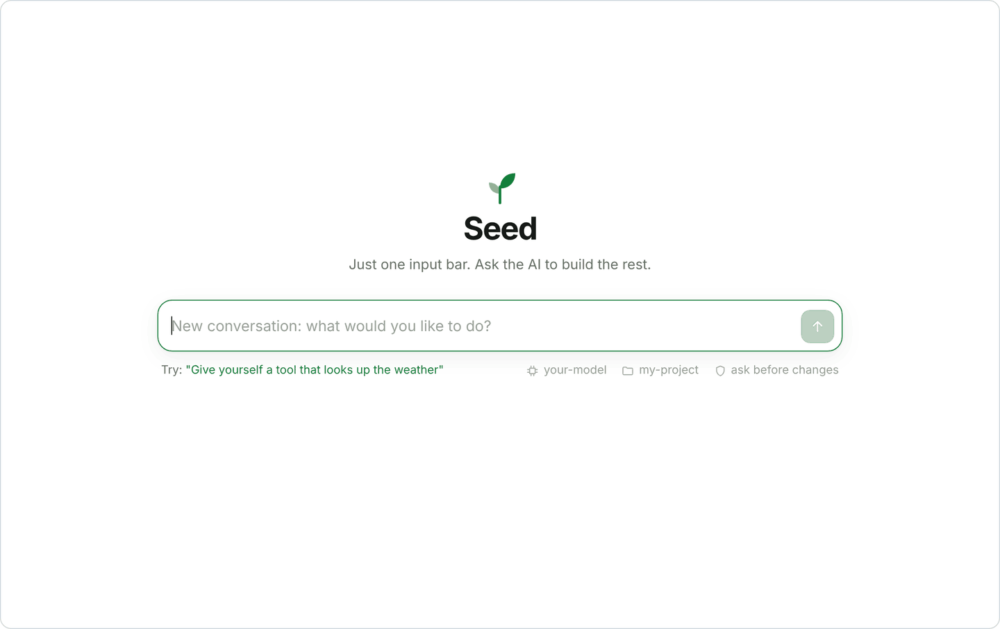
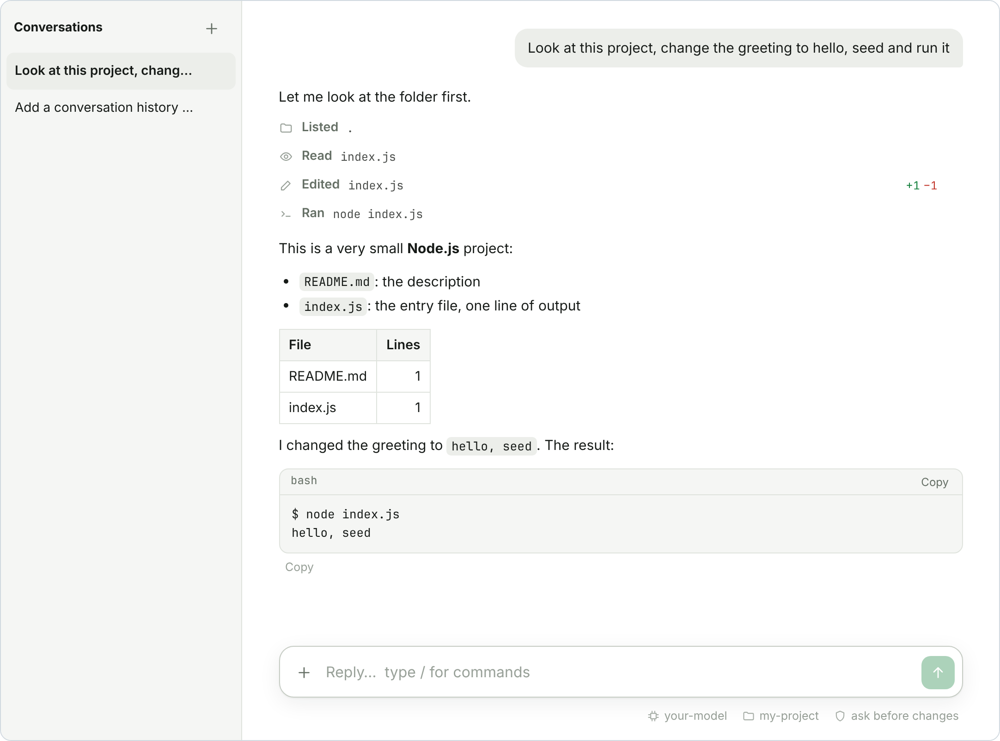
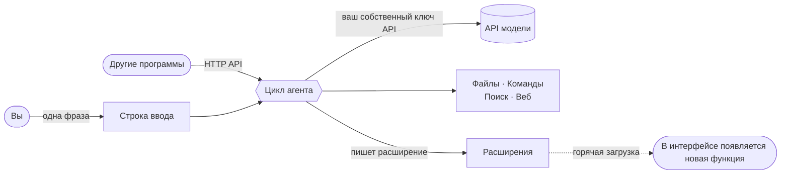
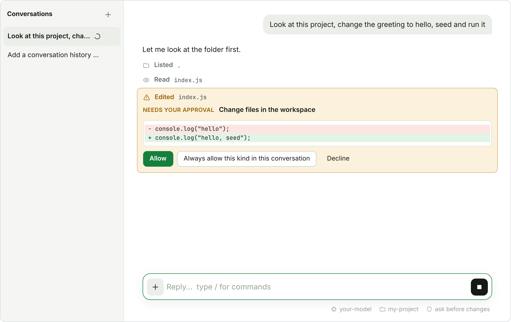

<div align="center">


# Seed

**ИИ-агент, у которого есть только строка ввода. Всё остальное создаёт сам ИИ.**

[简体中文](README.md) · [English](README.en.md) · [日本語](README.ja.md) · [Français](README.fr.md) · **Русский**

<p>
<a href="https://github.com/HolyGr41L1337/Seed/actions/workflows/ci.yml"></a>


</p>

<p>
<a href="https://github.com/HolyGr41L1337/Seed/releases/latest"></a>
&nbsp;
<a href="https://github.com/HolyGr41L1337/Seed/releases/latest"></a>
&nbsp;
<a href="https://github.com/HolyGr41L1337/Seed/releases/latest"></a>
</p>

[Скачать](#скачать-и-установить) · [Подключение API модели](#подключение-api-модели) · [Пусть ИИ добавляет функции](#пусть-ии-добавляет-функции) · [Работа через API](#работа-через-api) · [Документация](#документация-и-разработка)

</div>

<br>

Seed — это среда для запуска ИИ-агента (harness) в духе Codex и DeepSeek Harness: подключите API своей модели, и он будет читать и записывать файлы, выполнять команды, искать по коду и доводить задачи до конца на вашем компьютере.

Отличие в интерфейсе: сначала в нём нет ничего, кроме строки нового диалога. Боковая панель с историей, страница настроек, темы, новые инструменты, интеграции — ничего этого не встроено. Вы одной фразой просите ИИ добавить это в само приложение, и страница тут же обрастает новой функцией, без перезапуска.

<div align="center">
<picture>
  <source media="(prefers-color-scheme: dark)" srcset="docs/images/demo-en-dark.gif">
  
</picture>
<br>
<sub>Скажите ему «Добавь в это приложение боковую панель с историей диалогов» — ИИ напишет расширение, и панель сразу появится.<br>Записано в настоящем приложении; ответы модели заданы сценарием (интерфейс показан на английском).</sub>
</div>

## Возможности

<table>
<tr>
<td width="50%" valign="top">

**🤖 Полноценный агент**

Потоковые ответы, видимый ход рассуждений, вызовы инструментов (командная строка, чтение, запись и правка файлов, список каталога, glob, grep, загрузка веб-страниц, план задач), подтверждение каждого действия, остановка в любой момент, автоматическое сжатие длинных диалогов, чтение `AGENTS.md` из рабочей папки.

</td>
<td width="50%" valign="top">

**🌱 Растёт сам**

Каждую новую функцию ИИ пишет как расширение (обычные файлы JavaScript), которое подхватывается сразу после сохранения. Если загрузка не удалась, ошибка с именем файла и номером строки возвращается прямо к ИИ, и он исправляет код, пока всё не заработает.

</td>
</tr>
<tr>
<td width="50%" valign="top">

**🔌 API вашей модели**

DeepSeek, OpenAI, OpenRouter, Ollama и любой OpenAI-совместимый интерфейс; Claude — через официальный SDK Anthropic. Можно настроить несколько провайдеров и переключаться в любой момент, даже посреди диалога.

</td>
<td width="50%" valign="top">

**🧩 Управляется из других программ**

У всех функций есть HTTP API. Есть и OpenAI-совместимая точка доступа: направьте на Seed любой клиент, поддерживающий OpenAI, и используйте всего агента как одну «модель».

</td>
</tr>
</table>

Обычная задача по программированию выглядит так: файлы читаются без вопросов, перед правками и командами Seed спрашивает вас, а в конце даёт итог.

<div align="center">
<picture>
  <source media="(prefers-color-scheme: dark)" srcset="docs/images/chat-en-dark.png">
  
</picture>
</div>

## Как это работает



## Скачать и установить

На странице [Releases](https://github.com/HolyGr41L1337/Seed/releases/latest) в разделе **Assets** нажмите на файл для своей системы:

| Система | Файл | Как установить |
| --- | --- | --- |
| macOS (чип Apple: M1/M2/M3/M4…) | `Seed-<версия>-mac-arm64.dmg` | Откройте и перетащите Seed в «Программы» |
| macOS (Intel) | `Seed-<версия>-mac-x64.dmg` | Так же |
| Windows (большинство компьютеров) | `Seed-Setup-<версия>-x64.exe` | Запустите двойным щелчком; после установки приложение откроется само. Права администратора не нужны |
| Windows (без установки) | `Seed-<версия>-win-x64.zip` | Распакуйте и дважды щёлкните `Seed.exe` |
| Windows (компьютеры на ARM) | `Seed-Setup-<версия>-arm64.exe` | Запустите двойным щелчком |
| Linux | `Seed-<версия>-linux-x86_64.AppImage` | Сделайте файл исполняемым и запустите двойным щелчком |

Не знаете, какой чип в вашем Mac? Откройте меню Apple → «Об этом Mac». «Чип: Apple M…» — это arm64, «Процессор: Intel» — x64.

Приложение открывается окном, в котором есть только строка ввода, а под ней карточка «Connect a model API»: выберите провайдера, введите ключ API, нажмите «Connect» — и можно работать.

> [!IMPORTANT]
> Установщики пока не подписаны платными сертификатами Apple и Microsoft, поэтому при первом запуске система их блокирует. Один раз выполните действия ниже, и дальше приложение будет открываться как обычно.

- **macOS**: если появилось сообщение о том, что разработчика не удалось проверить или что Apple не смогла проверить приложение на наличие вредоносного ПО, нажмите «Готово». Затем откройте «Системные настройки → Конфиденциальность и безопасность», внизу страницы найдите сообщение о Seed и нажмите «Всё равно открыть». Либо один раз выполните в Терминале:

  ```bash
  xattr -dr com.apple.quarantine /Applications/Seed.app
  ```

- **Windows**: если появилось окно «Система Windows защитила ваш компьютер», нажмите «Подробнее», затем «Выполнить в любом случае». Если блокировку показывает «Интеллектуальное управление приложениями» и кнопки «Выполнить в любом случае» нет, отключите эту функцию в разделе «Безопасность Windows → Управление приложениями и браузером», а затем установите приложение.

<details>
<summary><b>Настольное приложение: меню и поведение</b></summary>

<br>

- **File → Open Folder…** (`Cmd/Ctrl+O`): папка, в которой ИИ читает и записывает файлы и выполняет команды. По умолчанию это ваша домашняя папка; лучше выбрать конкретный проект.
- **File → Copy API Connection Info**: копирует локальный адрес API и токен доступа, чтобы подключать другие программы (см. [Работа через API](#работа-через-api)).
- **View → Safe Mode**: если какое-то расширение сломало интерфейс, открывает окно без расширений интерфейса.

Настольное приложение автоматически использует системные настройки прокси (например, системный прокси, включённый прокси-клиентом), поэтому для доступа к OpenAI, Anthropic и другим сервисам ничего дополнительно настраивать не нужно. В macOS приложение продолжает работать после закрытия окна (API остаётся доступным); нажмите на значок в Dock, чтобы снова открыть окно, а полностью выйти можно через `Cmd+Q`.

Настольное приложение и версия для командной строки используют одни и те же данные (`~/.seed`): диалоги, настройки и расширения у них общие.

</details>

## Подключение API модели

Проще всего подключиться через карточку в самом приложении (введите `/connect`, чтобы открыть её снова в любой момент). Можно также задать переменные окружения перед запуском — Seed подхватит их сам:

| Переменная окружения | Провайдер |
| --- | --- |
| `ANTHROPIC_API_KEY` | Claude (Anthropic) |
| `DEEPSEEK_API_KEY` | DeepSeek |
| `OPENAI_API_KEY` (можно добавить `OPENAI_BASE_URL`) | OpenAI |
| `OPENROUTER_API_KEY` | OpenRouter |

Для других провайдеров выберите в карточке подключения «Custom (OpenAI-compatible)» или «Custom (Anthropic-compatible)» и укажите базовый URL, ключ и название модели.

Чтобы сменить модель, введите `/model` и выберите из списка либо введите `/model deepseek/deepseek-reasoner`.

<details>
<summary><b>Файл конфигурации целиком</b></summary>

<br>

Настройки хранятся в `~/.seed/config.json` (права доступа 600; ключи остаются только на вашем компьютере). Полная запись одного провайдера:

```json
{
  "providers": {
    "deepseek": {
      "type": "openai",
      "baseURL": "https://api.deepseek.com",
      "apiKey": "$DEEPSEEK_API_KEY",
      "params": { "max_tokens": 8192 },
      "contextWindow": 128000
    }
  },
  "model": "deepseek/deepseek-chat"
}
```

- В `apiKey` можно записать сам ключ или `"$ИМЯ_ПЕРЕМЕННОЙ"` — тогда ключ не попадает на диск.
- `params` без изменений добавляется в каждый запрос. Сюда записываются параметры, специфичные для провайдера (`temperature`, `reasoning_effort`, `thinking` у DeepSeek и так далее).
- `contextWindow` — длина контекста модели. Когда диалог приближается к ней, Seed просит модель сжать предыдущую часть в краткое изложение и продолжает работу.
- Модели вроде DeepSeek в режиме рассуждений требуют возвращать предыдущий `reasoning_content`. Seed делает это сам, а для интерфейсов, которые этого не допускают, переключается автоматически.
- Claude работает через официальный SDK. Модель по умолчанию — `claude-opus-5-5`, включены адаптивное мышление и кэширование промптов. Для моделей, которые это поддерживают, по умолчанию включён и **резервный ответ на стороне сервера** (если классификатор безопасности по ошибке заблокировал запрос, вместо него отвечает другая модель, рекомендованная Anthropic). Чтобы отключить его, добавьте `"fallbacks": false` в `params` этого провайдера. В `params` также можно задать `effort` (от `low` до `max`) и `maxTokens`.
- Если нужен прокси, задайте `HTTPS_PROXY` как обычно — Seed его учитывает.

</details>

## Пусть ИИ добавляет функции

Просто скажите:

- «Добавь в это приложение боковую панель с историей диалогов»
- «Добавь страницу настроек, где можно сменить модель и режим подтверждения»
- «Добавь кнопку переключения тёмной и светлой темы»
- «Добавь себе инструмент, который узнаёт погоду»
- «Добавь под каждым ответом кнопку озвучивания»

ИИ сначала читает [docs/EXTENDING.md](docs/EXTENDING.md), пишет расширение в `~/.seed/extensions/<имя>/`, вызывает `reload_extensions`, чтобы проверить результат загрузки, смотрит на настоящую страницу с помощью `ui_eval` и, убедившись, что всё работает, рассказывает, как этим пользоваться.

Расширения могут добавлять элементы интерфейса (боковые панели, панели, кнопки, полноэкранные представления, слэш-команды, сочетания клавиш) и серверные возможности (новые инструменты для ИИ, HTTP-интерфейсы, хуки, задачи по расписанию, новые типы API моделей).

- Введите `/extensions`, чтобы посмотреть, отключить или удалить расширения.
- Если расширение сломало интерфейс, введите `/safe` (или добавьте `?safe=1` к адресу), чтобы открыть страницу без расширений интерфейса, и попросите ИИ всё починить. `seed --safe` запускает Seed вообще без расширений.
- В [examples/extensions/](examples/extensions/) есть три готовых примера: боковая панель истории, переключатель темы и память между диалогами. Чтобы использовать пример как есть, скопируйте его папку в `~/.seed/extensions/`.

> [!NOTE]
> Код расширений имеет полные права (расширения интерфейса могут вызывать весь API, серверные расширения могут всё, что может Node.js), поэтому запись файлов расширений — отдельная категория подтверждения: во всех режимах, кроме `full`, Seed сначала спросит вас.

## Режимы подтверждения

Прежде чем сделать что-то с последствиями, ИИ спрашивает вас. На карточке три варианта: «Allow» (разрешить), «Always allow this kind in this conversation» (всегда разрешать такие действия в этом диалоге) и «Decline» (отклонить).

<div align="center">
<picture>
  <source media="(prefers-color-scheme: dark)" srcset="docs/images/approval-en-dark.png">
  
</picture>
</div>

| Режим | Поведение |
| --- | --- |
| `ask` (по умолчанию) | Файлы в рабочей папке читаются без вопросов. Выполнение команд, изменение файлов, доступ к сети и изменение настроек приложения требуют вашего согласия. Несколько команд, которые только читают (`ls`, `cat`, `git status` и подобные), выполняются без вопросов. |
| `auto-edit` | Изменения файлов внутри рабочей папки разрешаются автоматически, остальное — как выше. |
| `full` | Разрешено всё. |

Режим переключается командой `/mode`. После отказа ИИ останавливается и ждёт ваших указаний, а не ищет обходной путь.

## Работа через API

Токен доступа выводится при запуске; посмотреть его снова можно командой `seed url`. В настольном приложении используйте меню File → Copy API Connection Info.

**Как OpenAI-совместимый интерфейс** (базовый URL `http://127.0.0.1:7333/v1`, ключ API — токен доступа, модель `seed`):

```python
from openai import OpenAI

client = OpenAI(base_url="http://127.0.0.1:7333/v1", api_key="<токен доступа>")
reply = client.chat.completions.create(
    model="seed",
    messages=[{"role": "user", "content": "Какие TODO есть в этом репозитории?"}],
)
print(reply.choices[0].message.content)
```

При таком подключении некому нажимать на подтверждения, поэтому по умолчанию разрешено только чтение. Чтобы агент мог действовать, добавьте в запрос заголовок `x-seed-approval: auto-edit` или `full`.

**Один вызов — одна выполненная задача**:

```bash
curl http://127.0.0.1:7333/api/chat \
  -H "Authorization: Bearer <токен доступа>" -H "Content-Type: application/json" \
  -d '{"message": "Запусти тесты и кратко опиши причины падений", "approval": "full"}'
```

Добавьте `"stream": true`, чтобы получать поток событий в реальном времени. Управление диалогами, подтверждения, настройки, расширения, подписка на события и всё остальное описано в [docs/API.md](docs/API.md) (на английском).

## Команды

Введите `/` в строке ввода, чтобы открыть меню команд:

| Команда | Что делает |
| --- | --- |
| `/new` | Начать новый диалог |
| `/connect` | Подключить или сменить API модели |
| `/model [провайдер/модель]` | Показать или сменить модель |
| `/mode [ask\|auto-edit\|full]` | Сменить режим подтверждения |
| `/cd <папка>` | Сменить рабочую папку |
| `/compact` | Сжать раннюю часть диалога в краткое изложение |
| `/extensions` | Посмотреть расширения и управлять ими |
| `/stop` | Остановить текущую задачу |
| `/safe` | Заново открыть страницу в безопасном режиме |
| `/help` | Показать все команды (включая добавленные расширениями) |

<details>
<summary><b>Командная строка</b></summary>

<br>

```bash
seed                        # запуск (интерфейс + API)
seed --port 8080 --cwd ~/code/app
seed exec "почини упавшие тесты"       # без интерфейса: выполнить одну задачу в терминале
seed exec --approval full --json "…"   # для скриптов: разрешить всё, по одному JSON-событию в строке
seed url                    # показать адрес с токеном
seed --safe                 # запуск без расширений
```

Версия для командной строки устанавливается из исходного кода; см. [Документация и разработка](#документация-и-разработка).

</details>

## Безопасность

> [!WARNING]
> **Песочницы на уровне операционной системы нет.** Безопасность обеспечивают подтверждения: в режиме по умолчанию команды и изменения требуют вашего согласия. Режим `full` означает, что вы доверяете компьютер модели; включайте его, только когда доверяете содержанию задачи.

- По умолчанию сервер слушает только этот компьютер (`127.0.0.1`). Для всех интерфейсов нужен токен доступа. Вход в браузере действует только для страницы самого Seed, другие сайты воспользоваться им не могут. Если страница встроена в IDE или в облачную панель предпросмотра, где cookie не работают, она автоматически входит по токену.
- Файловые инструменты не открывают `~/.seed/config.json` (в нём ваши ключи), и в настройках, которые возвращает API, ключей тоже нет.
- Вывод модели считается недоверенным: интерфейс не отображает содержащийся в нём HTML, не загружает автоматически изображения из сети, а нажимать можно только на ссылки http(s) и mailto.
- Если вы открываете доступ из сети с помощью `--host 0.0.0.0`, токен становится единственным замком. HTTPS и брандмауэр добавьте сами.

## Текущие ограничения

- Адаптеры моделей написаны по открытым протоколам и проверены на имитационных серверах. В среде разработки не было настоящего ключа API, поэтому **с настоящими API DeepSeek, OpenAI и Anthropic они ещё не проверялись**. Если при первом подключении у провайдера обнаружится особое требование, обычно его можно учесть в `params` этого провайдера.
- Нет песочницы на уровне системы (см. выше).
- MCP, веб-поиск и интерфейс загрузки изображений пока не встроены (API уже принимает блоки с изображениями). Всё это ИИ может добавить в виде расширений.
- Автоматические тесты и смоук-тест настольного приложения выполняются в Linux, macOS и Windows (GitHub Actions), но приложением ещё не пользовались подолгу на компьютерах Mac и Windows обычных пользователей.
- Интерфейс пока доступен на китайском и английском языках и выбирается по языку системы. Изображения на этой странице показывают английский интерфейс.

## Документация и разработка

| Документ | Содержание |
| --- | --- |
| [docs/EXTENDING.md](docs/EXTENDING.md) | Справочник по расширениям (на английском). Именно его читает ИИ, когда добавляет функцию |
| [docs/API.md](docs/API.md) | Справочник по HTTP API (на английском) |
| [docs/ARCHITECTURE.md](docs/ARCHITECTURE.md) | Как части работают вместе и почему ключевые решения устроены именно так (на китайском) |
| [docs/DEVELOPMENT.md](docs/DEVELOPMENT.md) | Запуск из исходного кода, структура проекта, тесты, выпуск версий, подпись установщиков (на китайском) |

Для запуска из исходного кода нужен Node.js 22 или новее:

```bash
npm install
npm run desktop   # настольное приложение
npm start         # локальный веб-сервер, работа в браузере
```

Единственная зависимость времени выполнения — `@anthropic-ai/sdk` (настольное приложение дополнительно использует Electron). Этапа сборки нет: измените код и перезапустите.
